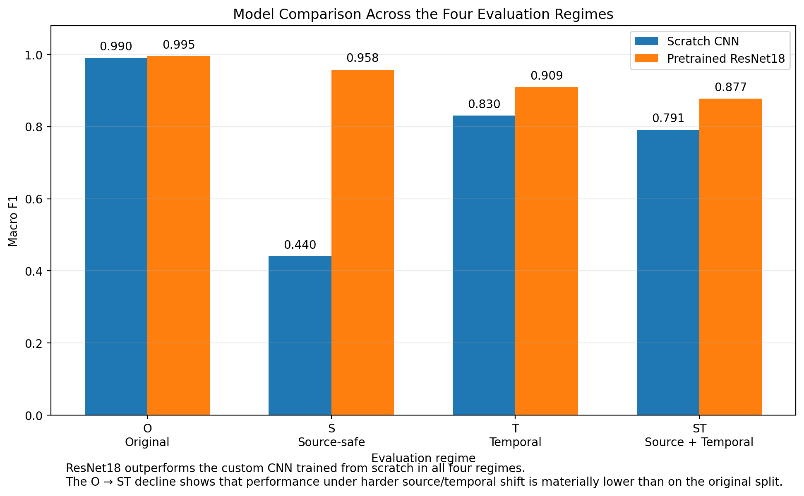

# MonReader — Flip / Not-Flip Image Classification

MonReader is a computer-vision project for classifying video frames as `flip` or `notflip`.

The project evaluates **O (Original), S (Source-safe), T (Temporal), and ST (Source + Temporal)** generalization regimes, compares a tuned Scratch CNN with ImageNet-pretrained ResNet18, tests **RGB vs grayscale**, and uses **Grad-CAM and intermediate activations** to inspect model attention, including possible reliance on hands and page regions.

## Project Workflow

1. **Data audit and split design** — inspect class balance and image filenames, extract environment/video identifiers and frame numbers, reconstruct the source-video structure and chronological order, and construct the O, S, T, and ST evaluation regimes.
2. **CNN model selection** — train and tune the Scratch CNN using the completed Weights & Biases (W&B) Bayesian searches, with validation-based selection.
3. **Model comparison** — compare the selected Scratch CNN with ImageNet-pretrained ResNet18 and test RGB vs grayscale inputs on held-out data.
4. **Generalization and stress testing** — evaluate source and temporal robustness, source-video bootstrap uncertainty, and failure patterns.
5. **Final analysis and interpretability** — consolidate results and use Grad-CAM and intermediate activations to investigate model behaviour.

## Evaluation Design

All four regimes used **balanced `flip` / `notflip` data** with separate **training, validation, and held-out test sets**. Training fitted the models; validation supported hyperparameter and checkpoint selection; held-out testing assessed the selected models.

| Regime | Meaning | Question answered |
| --- | --- | --- |
| **O** | Original | How accurately does the model classify frames when train, validation, and test data are randomly sampled from the dataset? |
| **S** | Source-safe | Can the model classify frames from source videos not seen during training or validation? |
| **T** | Temporal | Can the model classify later frames from known source videos? |
| **ST** | Source + Temporal | Can the model classify later frames from completely unseen source videos? |

**Original (O)** is the randomized, shuffled **frame-level** evaluation: frames are assigned to training, validation, and test without requiring complete source videos to stay within a single partition. This is distinct from source-disjoint or chronological evaluation.

The regimes progressively test whether apparently strong performance is partly dependent on familiar recordings or temporally similar frames. Because the **O regime randomly mixes frames without separating source videos**, its performance can appear stronger than the model's ability to generalize. Drops under **S, T, and ST** therefore provide important evidence about robustness under less familiar conditions.

### Representative Regime Examples

The figure illustrates what changes between the four regimes, using **real MonReader frames**. It illustrates the design rather than claiming that the particular displayed images prove an exact split assignment.


### Model Comparison and Key Results

The project compared a **custom convolutional neural network (CNN) trained from scratch** with an **ImageNet-pretrained ResNet18**. The table reports held-out **Macro F1** for both model families, avoiding a second, repetitive ResNet18-only results table.

| Regime | Scratch CNN Macro F1 | ResNet18 Macro F1 |
| --- | ---: | ---: |
| **O** | 0.990 | **0.995** |
| **S** | 0.440 | **0.958** |
| **T** | 0.830 | **0.909** |
| **ST** | 0.791 | **0.877** |

ResNet18 outperformed the Scratch CNN across all four regimes. The contrast was most pronounced in **S**, where the Scratch CNN deteriorated sharply while ResNet18 remained strong. This difference identifies a generalization problem worth investigating; it does not, by itself, identify which visual cues caused the Scratch CNN's weaker result.

ResNet18 itself declined from **0.995 in O to 0.877 in ST**. A near-perfect result under randomly mixed frames therefore did not translate into equally strong performance when both source identity and frame chronology changed.



## Hyperparameter Optimization

The custom CNN was tuned with **Weights & Biases Bayesian optimization**. A separate sweep was maintained for each of O, S, T, and ST, and the independent reproduction objective is **validation Macro F1**, maximized independently for each regime. Exactly the same Macro F1 definition is used for final held-out test reporting. The full research profile requests **30 qualifying Bayesian trials per regime**; failed, interrupted, hardware-infeasible/CUDA-OOM, non-finite, and zero-Macro-F1 attempts do not count toward the target. This notebook-based search is a new experiment: previous W&B runs are **not** downloaded or replayed.

| Hyperparameter | Search space |
| --- | --- |
| Optimizer | Adam, AdamW, SGD, RMSprop |
| Learning rate | log-uniform, `1e-5` to `1e-2` |
| Batch size | integer, 8 to 256 |
| Weight-decay mode | zero or positive |
| Positive weight decay | log-uniform, `1e-6` to `1e-2` |
| Dropout | uniform, 0.0 to 0.5 |
| CNN depth | integer, 1 to 7 convolution blocks |
| Starting filters | integer, 8 to 64 |

Training used a maximum of **50 epochs**, a fixed **0.50 decision threshold**, validation-based checkpoint selection, and early stopping. New trials use early-stopping **patience = 4** and validation batch size at most **32**. Independent scratch models are initialized and tuned separately for O, S, T and ST. Each ResNet18 model likewise starts independently from ImageNet-pretrained weights for that regime; models are not transferred sequentially from O to S to T to ST.

### Independent tuning and validation

Notebook 02 includes the complete training and hyperparameter-search code with per-epoch validation **Macro F1**, early stopping, trial accounting, the selected checkpoint, and training/tuning plots. By default, it runs an **offline Bayesian TPE search using Optuna**, which needs no W&B credentials. To use an independently created W&B Bayesian sweep instead, set `MONREADER_TUNER=wandb_bayes` before Notebook 01 and privately authenticate to W&B. The two optimization engines implement related but not identical search procedures; neither is claimed to recreate a previous W&B trial sequence. The notebook deliberately does **not** display a list of the author's former winning runs or their hyperparameters.

The model's number of trainable parameters depends on convolution depth and starting filter width, which vary in the search. ResNet18 uses a fixed pretrained residual architecture with a replaced binary output layer; the notebook computes actual parameter counts from the instantiated models. Regularization, width, batch size and optimizer settings may vary substantially between independently selected regimes, so the code reports the winning settings of **the reader's run**, rather than assuming one configuration generalizes to all four partitions.

## Robustness and Uncertainty

Individual frames from the same video are not fully independent: neighbouring frames can be visually very similar. Treating every frame as an unrelated observation could therefore make the model's performance appear more certain than it really is.

To account for this, **source-video bootstrapping** was used. Instead of repeatedly resampling individual frames, the analysis repeatedly resampled entire source videos and recalculated Macro F1. The resulting **95% confidence intervals** summarize variation under source-level resampling.

ResNet18, the stronger model, achieved:

| Regime | ResNet18 Macro F1 | 95% source-video bootstrap CI |
| --- | ---: | --- |
| **O** | 0.995 | **[0.986, 1.000]** |
| **S** | 0.958 | **[0.910, 0.993]** |
| **T** | 0.909 | **[0.866, 0.947]** |
| **ST** | 0.877 | **[0.748, 0.972]** |

The scores decrease in the more demanding regimes, while the particularly wide **ST interval** reflects greater uncertainty across the resampled source-video population when source and temporal restrictions are combined.

## RGB vs Grayscale

A controlled **Scratch CNN** ablation compared RGB and grayscale versions of the same held-out images to test whether colour information materially influenced classification.

| Regime | RGB Macro F1 | Grayscale Macro F1 | Δ Grayscale − RGB |
| --- | ---: | ---: | ---: |
| **O** | 0.990 | **0.997** | +0.007 |
| **ST** | **0.791** | 0.690 | −0.101 |

Although grayscale performed slightly better in **O** and worse in **ST**, the recorded paired source-video bootstrap intervals included zero in both regimes. The analysis therefore did **not provide sufficient evidence that colour was a consistent or meaningful driver of performance**.

The image pairs below show the **same held-out `flip` and `notflip` frames before and after grayscale conversion**.


## Grad-CAM and Interpretability

Grad-CAM was applied to the **ImageNet-pretrained ResNet18** to examine which image regions contributed most strongly to its predictions.

A fixed set of **21 cases** was chosen before visual inspection to cover confident correct predictions, borderline decisions, and errors across O, S, T, and ST. The clean **4 × 4 matrix** presents **16 representative overlays**: rows correspond to O/S/T/ST and columns to correct `notflip`, correct `flip`, high-confidence error, and borderline error. The remaining selected cases belong to the complete 21-case analysis.


Across the selected cases:

- **Correct `flip` predictions** typically emphasized raised or curved page surfaces, page edges/folds, and nearby hand–page interactions.
- **Correct `notflip` predictions** more often concentrated on a hand resting against the page and an adjacent page boundary.
- **High-confidence errors** frequently concentrated on hands or high-contrast page regions despite the prediction being wrong.
- **Borderline errors** tended to show more diffuse or displaced attention across hands, page content, or margins.

The overlays indicate associations between predictions and visible regions; they are **not causal proof** that a particular feature was responsible for a decision. Intermediate-layer activations provide an additional view of how the ResNet18 representations change through the network and are documented in Notebook 05.

## Failure Analysis

Failure analysis was performed on **ResNet18**, the stronger final reference model, because it outperformed the Scratch CNN across all four evaluation regimes.

| Regime | Errors | Error Rate | False Positives | False Negatives | High-Confidence Errors |
| --- | ---: | ---: | ---: | ---: | ---: |
| **O** | 3 | 0.5% | 0 | 3 | 33% |
| **S** | 25 | 4.1% | 12 | 13 | 32% |
| **T** | 27 | 9.0% | 0 | 27 | 52% |
| **ST** | 14 | 11.6% | 0 | 14 | 79% |

In **T and ST, every recorded error was a false negative**: the model missed real page flips but did not predict flips for frames labelled `notflip`. Under these conditions, the model made more missed-flip errors rather than false alarms.

For deployment, the main risk is therefore **missed page turns**, and many of these errors occur even when the model is highly confident. A simple confidence cutoff is not a reliable safeguard. Lowering the `flip` decision threshold could recover some missed flips but may also introduce false positives; that trade-off would need to be evaluated using validation data and checked separately on held-out test data.

## Conclusion and Recommendation

**ResNet18 was the strongest model** across all four regimes, but its Macro F1 declined as source and temporal generalization became more demanding.

The main practical limitation is not simply a lower score: under T and ST, errors were entirely false negatives and many occurred with high confidence. This means the classifier can miss genuine page turns without appearing uncertain.

The model is promising for MonReader, but **should not yet be treated as deployment-ready without further testing on independent unseen recordings and targeted work to reduce confident false negatives**.

## Limitations and Next Steps

The dataset is relatively small and comes from a limited number of reconstructed source recordings, so measured performance may not cover the full range of books, users, lighting conditions, camera angles, and page-turning styles encountered in practice.

Next priorities are broader testing on unseen recording sources, investigation of high-confidence false negatives, and assessment of robustness when the recording conditions differ from those represented in the present dataset.

## Reproducing the Project

The five self-contained notebooks together form an executable **technical report**. Each question is followed by the method and runnable Python code; tables, models and figures are calculated from the active dataset rather than hard-coded from this README. In a fresh experiment, results can differ from the reference observations above and **no assertion forces them to match**.

1. Install Python 3.11+ with `numpy`, `pandas`, `Pillow`, `matplotlib`, `scikit-learn`, `torch`, `torchvision`, `optuna`, `nbformat`, `nbclient`, `ipykernel` (and optionally `wandb`). For full model training, install a compatible PyTorch build for your hardware.
2. Provide the **original MonReader images** under `data/raw/`, preserving `training/flip`, `training/notflip`, `testing/flip` and `testing/notflip` folders and the `environment_frame.jpg` naming convention. Alternatively set `MONREADER_DATA_ROOT` to the directory containing that structure. No synthetic frames are included as scientific data.
3. Run **01 → 02 → 03 → 04 → 05**, starting each notebook in the project root. Notebook 01 generates the common transparent Python methods in `generated/` (the source code is embedded directly inside Notebook 01). All generated files are local and ignored by the deliverable.
4. Notebook 02 executes a new Bayesian search. The default Optuna path is **offline**; optional W&B tracking/search requires your own account. Notebook 03 independently trains four ResNet18 models and two grayscale scratch CNNs. Notebook 04 calculates source-video uncertainty and errors. Notebook 05 computes class-directed Grad-CAM and intermediate activations from the active trained checkpoints.
5. For a synthetic code check only, set `MONREADER_SMOKE_TEST=1` before running Notebook 01 and point `MONREADER_DATA_ROOT` to a separately created synthetic dataset. This lowers compute for testing and **does not** constitute a MonReader scientific result.

The four figures displayed in this README are the **approved reference illustrations**. The matching visualization procedures in the notebooks generate their own files under `generated/outputs/figures/` using whichever images, predictions and weights the researcher trained. The layout is reproducible; frame choices and model heatmaps may differ on a fresh run.

**Metric rule:** Only **Macro F1** is used for checkpoint selection, Bayesian optimization and test comparison. The test set is not used in model selection. Additional accuracy, ROC-AUC, precision and recall diagnostics do not introduce another F1 objective.

## Repository Guide

```text
MonReader/
├── README.md
├── 01_data_and_splits.ipynb
├── 02_cnn_selection.ipynb
├── 03_model_comparison.ipynb
├── 04_generalization_and_stress_tests.ipynb
├── 05_final_analysis.ipynb
├── data/raw/                    # original dataset supplied separately
└── figures/                     # four README figures
```

The repository needs no tracked `src/`, `results/` or W&B export directory. Notebook 01 writes its shared code to a generated local file so notebooks can execute in separate Jupyter kernels; results, logs, checkpoints and regenerated figures are also stored locally. The four image files above are retained solely because GitHub Markdown requires accessible image assets for inline figures.

### Notebook Guide

| Notebook | Purpose |
|---|---|
| `01_data_and_splits.ipynb` | Inspect real image filenames, construct a canonical manifest, audit sources and chronology, and create/fingerprint O/S/T/ST splits and the regime figure |
| `02_cnn_selection.ipynb` | Fresh scratch-CNN training and Bayesian hyperparameter tuning with **validation Macro F1**, checkpoint selection and tuning/training plots |
| `03_model_comparison.ipynb` | Independent ResNet18 fine-tuning, held-out comparison, grayscale scratch-CNN controls and figures |
| `04_generalization_and_stress_tests.ipynb` | Source-video bootstrap confidence intervals, paired grayscale uncertainty and error diagnostics |
| `05_final_analysis.ipynb` | Frozen prediction-based case selection, predicted-class Grad-CAM, activation maps and limitations |

**Status of code verification:** the notebooks have been executed in sequence on a *synthetic image fixture* to validate that their code paths work. This does not independently verify or regenerate the historical MonReader reference scores; that requires the original dataset, model training and sufficient compute.