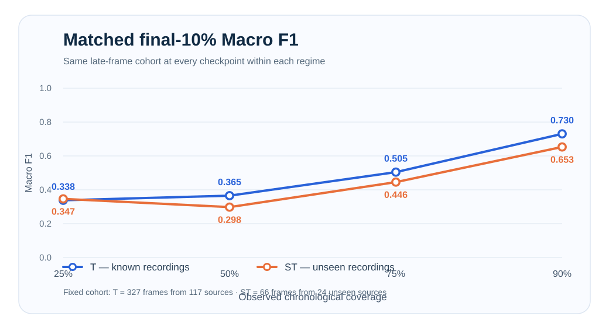
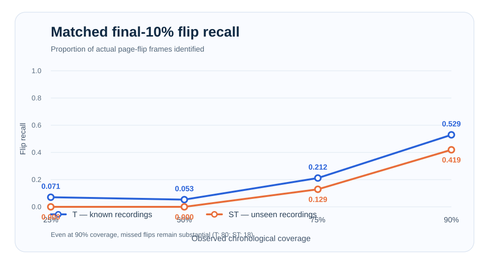

# MonReader — Flip / Not-Flip Image Classification

MonReader is a computer-vision project for classifying video frames as `flip` or `notflip`.

The project evaluates **O (Original), S (Source-safe), T (Temporal), and ST (Source + Temporal)** generalization regimes, compares a tuned Scratch CNN with ImageNet-pretrained ResNet18, tests **RGB vs grayscale**, and uses **Grad-CAM and intermediate activations** to inspect model attention, including possible reliance on hands and page regions.

## Research status and provenance

**This README documents the completed historical Bayesian-optimisation experiment and a separately completed progressive-temporal ResNet18 extension.** The original scratch-CNN methodology used **four independent W&B Bayesian searches with 30 qualifying trials per regime (120 total)**; the accepted historical tables and figures are presented from archived outcomes, without claiming that the five `updated_` notebooks repeated those expensive searches. The historical held-out populations were O=597, S=610, T=301 and ST=121 frames. In original ST, **489 earlier frames from 24 withheld recordings were context-only**, excluded from model training/validation and the historical late-only test. Both experimental populations and score definitions are kept distinct.

The supplementary **progressive temporal ResNet18 experiment completed on 3 November 2026 (8/8 GPU + W&B runs)**. See [the finalized measured results and conclusions](docs/PROGRESSIVE_TEMPORAL_FINAL_RESULTS_2026-11-03.md). The underlying dataset does not establish capture days or actual time intervals.

## Dataset

The original MonReader image dataset is available as [**images.zip — Google Drive**](https://drive.google.com/file/d/1KDQBTbo5deKGCdVV_xIujscn5ImxW4dm/view?usp=sharing). Download and extract the archive into `data/raw/`, preserving the `training/flip`, `training/notflip`, `testing/flip` and `testing/notflip` directories and their original filenames. Alternatively, configure `MONREADER_DATA_ROOT` to point to the extracted dataset root. The image archive is distributed through the dataset link rather than stored in this Git repository.

## Project Workflow

1. **Data audit and split design** — inspect class balance and image filenames, extract environment/video identifiers and frame numbers, reconstruct the source-video structure and chronological order, and construct the O, S, T, and ST evaluation regimes.
2. **CNN model selection** — use **four independent Weights & Biases (W&B) Bayesian hyperparameter searches**, each with **30 qualifying completed runs**, to select a scratch-CNN configuration by **validation Macro F1** (120 qualifying trials total).
3. **Model comparison** — compare the selected Scratch CNN with ImageNet-pretrained ResNet18 and test RGB vs grayscale inputs on held-out data.
4. **Generalization and stress testing** — evaluate source and temporal robustness, source-video bootstrap uncertainty, failure patterns, and the separate progressive T/ST proof of principle.
5. **Final analysis and interpretability** — consolidate results and use Grad-CAM and intermediate activations to investigate model behaviour.

## Evaluation Design

All four regimes used the **same original, approximately balanced `flip` / `notflip` dataset** with separate **training, validation, and held-out test sets**. Training fitted the models; validation supported hyperparameter and checkpoint selection; held-out testing assessed the selected models.

| Regime | Meaning | Question answered |
| --- | --- | --- |
| **O** | Original | How accurately does the model classify frames under the dataset's supplied train/test partition? |
| **S** | Source-safe | Can the model classify frames from source videos not seen during training or validation? |
| **T** | Temporal | Can the model classify later frames from known source videos? |
| **ST** | Source + Temporal | Can the model classify later frames from completely unseen source videos? |

**Original (O)** preserves the dataset's supplied training/testing folder membership and takes validation images only from the supplied training folder. Frames are not guaranteed independent across the original partitions: the same reconstructed video source can contribute frames to both training and test. The supplied test set has 597 images.

The regimes progressively test whether apparently strong performance is partly dependent on familiar recordings or temporally similar frames. Because the **O regime does not separate source videos across training and testing**, its performance can appear stronger than the model's ability to generalize. Drops under **S, T, and ST** therefore provide important evidence about robustness under less familiar conditions.

### How Testing Was Performed

Each evaluation regime used separate **training, validation and held-out test** partitions. The training partitions were used to fit the models, and the validation partitions were used to select hyperparameters, training epochs and checkpoints using **Macro F1**. The held-out test partitions were evaluated after model selection, with a fixed **0.50 classification threshold**, and were not used to choose models or tune thresholds.

Testing was performed under four complementary conditions: the original supplied train/test division (**O**), unseen recording sources (**S**), later frames from known recordings (**T**), and later frames from unseen recording sources (**ST**). The Scratch CNN and ImageNet-pretrained ResNet18 were evaluated in each regime. Additional held-out diagnostics included accuracy, precision, recall, confusion-matrix errors, and confidence. Source-video bootstrap resampling (**5,000 repetitions**) produced 95% Macro-F1 confidence intervals, while paired source-video resampling assessed the RGB-versus-grayscale comparison on matching test frames in O and ST. Grad-CAM and intermediate activations were used to examine selected ResNet18 predictions and errors.

### Representative Regime Examples

The figure illustrates what changes between the four regimes, using **real MonReader frames**. It illustrates the design rather than claiming that the particular displayed images prove an exact split assignment.

<p align="center"></p>

### Model Comparison and Key Results

The project compared a **custom convolutional neural network (CNN) trained from scratch** with an **ImageNet-pretrained ResNet18**. The table reports held-out **Macro F1** for both model families, avoiding a second, repetitive ResNet18-only results table.

| Regime | Scratch CNN Macro F1 | ResNet18 Macro F1 |
| --- | ---: | ---: |
| **O** | 0.990 | **0.995** |
| **S** | 0.440 | **0.958** |
| **T** | 0.830 | **0.909** |
| **ST** | 0.791 | **0.877** |

ResNet18 outperformed the Scratch CNN across all four regimes. The contrast was most pronounced in **S**, where the Scratch CNN deteriorated sharply while ResNet18 remained strong. This difference identifies a generalization problem worth investigating; it does not, by itself, identify which visual cues caused the Scratch CNN's weaker result.

ResNet18 itself declined from **0.995 in O to 0.877 in ST**. A near-perfect result under the original source-overlapping supplied partition therefore did not translate into equally strong performance when both source identity and frame chronology changed.

<p align="center"></p>

## Hyperparameter Optimization

The Scratch CNN was tuned using **Weights & Biases (W&B) Bayesian optimization**, with a separate search for each of O, S, T and ST. The selection objective was **validation Macro F1**, with **30 qualifying trials per regime**. Failed, interrupted, CUDA out-of-memory, non-finite and zero-Macro-F1 attempts were excluded from the qualifying count.

| Hyperparameter | Search space |
| --- | --- |
| Optimizer | Adam, AdamW, SGD, RMSprop |
| Learning rate | log-uniform, `1e-5` to `1e-2` |
| Batch size | integer, 8 to 256 |
| Weight-decay mode | zero or positive |
| Positive weight decay | log-uniform, `1e-6` to `1e-2` |
| Dropout | uniform, 0.0 to 0.5 |
| CNN depth | integer, 1 to 7 convolution blocks |
| Starting filters | integer, 8 to 64 |

Training used a maximum of **50 epochs**, a fixed **0.50 decision threshold**, validation-based checkpoint selection, and early stopping. New trials use early-stopping **patience = 4** and validation batch size at most **32**. Independent scratch models are initialized and tuned separately for O, S, T and ST. Each ResNet18 model likewise starts independently from ImageNet-pretrained weights for that regime; models are not transferred sequentially from O to S to T to ST.

## Robustness and Uncertainty

Individual frames from the same video are not fully independent: neighbouring frames can be visually very similar. Treating every frame as an unrelated observation could therefore make the model's performance appear more certain than it really is.

To account for this, **source-video bootstrapping** was used. Instead of repeatedly resampling individual frames, the analysis repeatedly resampled entire source videos and recalculated Macro F1. The resulting **95% confidence intervals** summarize variation under source-level resampling.

ResNet18, the stronger model, achieved:

| Regime | ResNet18 Macro F1 | 95% source-video bootstrap CI |
| --- | ---: | --- |
| **O** | 0.995 | **[0.986, 1.000]** |
| **S** | 0.958 | **[0.910, 0.993]** |
| **T** | 0.909 | **[0.866, 0.947]** |
| **ST** | 0.877 | **[0.748, 0.972]** |

The scores decrease in the more demanding regimes, while the particularly wide **ST interval** reflects greater uncertainty across the resampled source-video population when source and temporal restrictions are combined.

## RGB vs Grayscale

A controlled **Scratch CNN** ablation compared RGB and grayscale versions of the same held-out images to test whether colour information materially influenced classification.

| Regime | RGB Macro F1 | Grayscale Macro F1 | Δ Grayscale − RGB |
| --- | ---: | ---: | ---: |
| **O** | 0.990 | **0.997** | +0.007 |
| **ST** | **0.791** | 0.690 | −0.101 |

Although grayscale performed slightly better in **O** and worse in **ST**, the recorded paired source-video bootstrap intervals included zero in both regimes. The analysis therefore did **not provide sufficient evidence that colour was a consistent or meaningful driver of performance**.

The image pairs below show the **same held-out `flip` and `notflip` frames before and after grayscale conversion**.

<p align="center"></p>

## Grad-CAM and Interpretability

Grad-CAM was applied to the **ImageNet-pretrained ResNet18** to examine which image regions contributed most strongly to its predictions.

A fixed set of **21 cases** was chosen before visual inspection to cover confident correct predictions, borderline decisions, and errors across O, S, T, and ST. The clean **4 × 4 matrix** presents **16 representative overlays**: rows correspond to O/S/T/ST and columns to correct `notflip`, correct `flip`, high-confidence error, and borderline error. The remaining selected cases belong to the complete 21-case analysis.

<p align="center"></p>

Across the selected cases:

- **Correct `flip` predictions** typically emphasized raised or curved page surfaces, page edges/folds, and nearby hand–page interactions.
- **Correct `notflip` predictions** more often concentrated on a hand resting against the page and an adjacent page boundary.
- **High-confidence errors** frequently concentrated on hands or high-contrast page regions despite the prediction being wrong.
- **Borderline errors** tended to show more diffuse or displaced attention across hands, page content, or margins.

The overlays indicate associations between predictions and visible regions; they are **not causal proof** that a particular feature was responsible for a decision. Intermediate-layer activations provide an additional view of how the ResNet18 representations change through the network and are documented in Notebook 05.

## Failure Analysis

Failure analysis was performed on **ResNet18**, the stronger final reference model, because it outperformed the Scratch CNN across all four evaluation regimes.

| Regime | Errors | Error Rate | False Positives | False Negatives | High-Confidence Errors |
| --- | ---: | ---: | ---: | ---: | ---: |
| **O** | 3 | 0.5% | 0 | 3 | 33% |
| **S** | 25 | 4.1% | 12 | 13 | 32% |
| **T** | 27 | 9.0% | 0 | 27 | 52% |
| **ST** | 14 | 11.6% | 0 | 14 | 79% |

In **T and ST, every recorded error was a false negative**: the model missed real page flips but did not predict flips for frames labelled `notflip`. Under these conditions, the model made more missed-flip errors rather than false alarms.

For deployment, the main risk is therefore **missed page turns**, and many of these errors occur even when the model is highly confident. A simple confidence cutoff is not a reliable safeguard. Lowering the `flip` decision threshold could recover some missed flips but may also introduce false positives; that trade-off would need to be evaluated using validation data and checked separately on held-out test data.

## Progressive temporal updating — completed 3 November 2026

A **supplementary, completed GPU experiment** investigated how supervised updates from progressively larger chronological prefixes affect frame-level page-flip classification. It uses two independent ImageNet-pretrained **ResNet18** model sequences: **T** is trained on earlier frames from the same sources it later evaluates; **ST** is trained only on known-source videos and evaluates later frames from the **24 original ST withheld sources**, which never enter progressive ST training or validation. The experiment ran at **25%, 50%, 75% and 90%** observed frame coverage, producing **eight completed and W&B-synchronised runs**.

The initial 25% stage uses a frozen-backbone head-training stage followed by fine-tuning. At later coverage checkpoints, each regime's own model is updated with additional labelled frames. **T and ST are not fine-tuned from one another.** W&B tracking is separate from the completed 120 qualifying historical scratch-CNN trials.

### Final held-out results

The **remaining-future** suffix changes in size and composition at each coverage level. The **matched final-10%** cohort remains the **same 327 frames** for all T checkpoints and the **same 66 frames** for all ST checkpoints. All scores below are *Macro F1* or positive-class *flip recall* (0–1 scale), not accuracy.

| Regime | Coverage | Remaining future frames | Future Macro F1 | Future flip recall | Matched final-10% Macro F1 | Matched final-10% flip recall |
| :---: | ---: | ---: | ---: | ---: | ---: | ---: |
| T | [25%](https://forge.coreweave.com/wandb/nickthegreek/monreader-progressive-temporal/runs/ef0bd109) | 2,291 | 0.7398 | 0.5727 | 0.3383 | 0.0706 |
| T | [50%](https://forge.coreweave.com/wandb/nickthegreek/monreader-progressive-temporal/runs/d3f7ebef) | 1,510 | 0.7077 | 0.4831 | 0.3655 | 0.0529 |
| T | [75%](https://forge.coreweave.com/wandb/nickthegreek/monreader-progressive-temporal/runs/be3d8e8b) | 799 | 0.6983 | 0.4730 | 0.5046 | 0.2118 |
| T | [90%](https://forge.coreweave.com/wandb/nickthegreek/monreader-progressive-temporal/runs/1f2d7368) | 327 | 0.7304 | 0.5294 | 0.7304 | 0.5294 |
| ST | [25%](https://forge.coreweave.com/wandb/nickthegreek/monreader-progressive-temporal/runs/482cb32b) | 467 | 0.6620 | 0.3561 | 0.3465 | 0.0000 |
| ST | [50%](https://forge.coreweave.com/wandb/nickthegreek/monreader-progressive-temporal/runs/e4c974c8) | 309 | 0.6955 | 0.4672 | 0.2979 | 0.0000 |
| ST | [75%](https://forge.coreweave.com/wandb/nickthegreek/monreader-progressive-temporal/runs/a64aec3c) | 164 | 0.6288 | 0.3562 | 0.4457 | 0.1290 |
| ST | [90%](https://forge.coreweave.com/wandb/nickthegreek/monreader-progressive-temporal/runs/4d6a8aa7) | 66 | 0.6531 | 0.4194 | 0.6531 | 0.4194 |

## Progressive T (Temporal) — later frames from familiar sources

**Historical benchmark (accepted, separate protocol).** Under the original chronological T partition, all **117 reconstructed recordings** contributed early frames for model development and later frames for testing: **2,387 training, 301 validation, and 301 held-out test frames**. The historical ResNet18 achieved **0.9091 Macro F1** on those 301 test frames; Scratch CNN achieved **0.8305**. ResNet18 recorded **27 false negatives and no false positives**. Its historical 95% **source-video bootstrap** Macro-F1 interval was approximately **[0.862, 0.947]**. This is an estimate for later frames of *known* sources, not generalization to new recordings.

**Completed progressive T study (3 November 2026).** The supplementary ResNet18 was updated successively after 25%, 50%, 75% and 90% labelled chronological coverage. The *matched final-10%* test cohort contained **327 identical frames from the 117 familiar sources** at every checkpoint. Macro F1 on this fixed cohort was **0.3383 → 0.3655 → 0.5046 → 0.7304**, while flip recall was **0.0706 → 0.0529 → 0.2118 → 0.5294**. Despite the final improvement, at 90% coverage the classifier still missed **80 actual flip frames** (and produced 5 false positives) on these 327 frames.

**Interpretation.** The matched-cohort improvement is a descriptive association with additional supervised training, not a controlled causal estimate. The changing remaining-future sets (2,291 down to 327 frames) must not be compared as identical test populations. Qualified three-position horizon windows showed lower scores further from the available prefix at 25% coverage (Macro F1 **0.9656** at positions 1–3 versus **0.4617** at positions 19–21), without establishing elapsed-time or real-world concept drift.

## Progressive ST (Source + Temporal) — later frames from unseen sources

**Historical benchmark (accepted, separate protocol).** The original ST split withheld **24 complete source recordings** from model training and validation. Across all 2,989 images, its roles were **1,904 training**, **475 validation**, **489 earlier frames from unseen sources marked context only**, and **121 later unseen-source test frames**. The 489 context frames were deliberately not used for fitting or selection, and were not part of the historical **late-only** score. On the 121 test frames, ResNet18 achieved **0.8772 Macro F1** (Scratch CNN **0.7906**), with **14 false negatives and zero false positives**. The historical 95% source-video bootstrap interval was approximately **[0.747, 0.972]**; uncertainty is substantial because the unseen test cohort is small.

**Completed progressive ST study (3 November 2026).** A *different ResNet18 sequence* was updated from labelled early frames of **known** recordings only. The same **24 unseen recordings remained completely absent from both ST training and validation at all four checkpoints**. Their matched final-10% evaluation cohort comprised **66 identical frames** at every checkpoint. Across 25%, 50%, 75% and 90% training coverage, fixed-cohort Macro F1 was **0.3465 → 0.2979 → 0.4457 → 0.6531**; flip recall was **0.0000 → 0.0000 → 0.1290 → 0.4194**. At 90% coverage, the model still missed **18 of 31 actual flips** in the 66-frame cohort (and produced 3 false positives). The score did **not** increase monotonically.

**Why the 489 frames remain protected.** At early progressive checkpoints, the *newly defined* ST evaluation suffix can score some images that were among the historical 489 earlier context-only frames; none ever enters model training or validation. This separate supplementary evaluation does **not** redefine the historical 121-frame ST test or replace its **0.8772** result. Later-frame order is reconstructed from filenames; no actual time intervals, prospective predictions, online learning or independent-environment guarantee is established.

**Practical interpretation.** ST gives the more stringent *unseen-source* perspective, but the 66-frame matched suffix is too small to justify deployment claims or definitive cross-regime rankings. Missed page turns remain the principal operational concern. The T and ST progressive cohorts differ, so their scores must not be interpreted as the isolated causal effect of source novelty.

The complete eight-run outcome table, per-checkpoint support counts, and W&B links are recorded in the [completed progressive results note](docs/PROGRESSIVE_TEMPORAL_FINAL_RESULTS_2026-11-03.md) and [committed eight-run summary](submission/results/progressive_temporal_completed_8_runs.csv).

### Illustrative results figures

The following **two tracked SVG figures** are redrawn from the eight measured final-result records, not speculative curves or images from a pending run. They highlight **fixed-cohort comparisons within each regime**, rather than treating changing future populations as directly comparable.



*Figure 1.* On the fixed final-10% frames, T Macro F1 rises from **0.3383 to 0.7304** and ST Macro F1 from **0.3465 to 0.6531** between 25% and 90% coverage. ST dips at 50%; improvement is not uniformly monotonic. T and ST use different source populations and must not be interpreted as a causal head-to-head comparison.



*Figure 2.* Flip recall on those same fixed test cohorts remains low at early checkpoints. At 90% coverage it reaches **0.5294 for T** and **0.4194 for ST**. The model still misses **80 actual flip frames in T** and **18 in ST** on the matched final suffix.

### Scientific interpretation and boundaries

**The main finding is a generalization gap:** nearly perfect in-prefix validation scores did not imply reliable predictions on later frames. Increased labelled historical coverage is associated with better performance on the same protected final suffix at the 90% checkpoint, but gains are uneven, and missed flips remain a significant operational failure mode. Whole-future metrics answer a different question because the future suffix progressively shrinks; do not rank checkpoints on those scores alone.

Only **qualified three-frame horizon windows** are reported: each requires at least 20 frames and 8 source recordings per class. In the T 25% run, Macro F1 drops from **0.9656** at future positions 1–3 to **0.4617** at positions 19–21; ST 25% falls from **0.8322** at positions 1–3 to **0.4254** at positions 13–15. Unsupported later windows are marked unreportable instead of presented as zero.

**Historical-versus-progressive ST distinction:** the progressive ST suffix at early checkpoints can contain frames that were part of the **489 historical context-only frames**; they are *never used for training* and are used solely for this **separate** new evaluation. The historical ST Macro F1 of **0.8772 on 121 late-test frames** is preserved and is not replaced by any progressive ST score.

This retrospective study uses reconstructed frame order, **not verified capture timestamps**. It does **not** establish elapsed-time drift, future-event forecasting, automatic online learning, or readiness for unattended deployment. The fixed ST matched cohort contains just **66 frames across 24 sources**, so apparent gains need cautious interpretation.

**Evidence:** [Final results, protocol details and eight W&B runs](docs/PROGRESSIVE_TEMPORAL_FINAL_RESULTS_2026-11-03.md) · [W&B project](https://forge.coreweave.com/wandb/nickthegreek/monreader-progressive-temporal). Notebook 04 writes the per-frame predictions, horizon CSVs and original four PNG plots locally under `generated/outputs/progressive_temporal/`; the two compact comparison SVGs above are **committed to the repository** so GitHub renders them without requiring local files.

## Conclusion and Recommendation

**ResNet18 was the strongest model** across all four regimes, but its Macro F1 declined as source and temporal generalization became more demanding.

The main practical limitation is not simply a lower score: under T and ST, errors were entirely false negatives and many occurred with high confidence. This means the classifier can miss genuine page turns without appearing uncertain.

The model is promising for MonReader, but **should not yet be treated as deployment-ready without further testing on independent unseen recordings and targeted work to reduce confident false negatives**.

## Limitations and Next Steps

The dataset is relatively small and comes from a limited number of reconstructed source recordings, so measured performance may not cover the full range of books, users, lighting conditions, camera angles, and page-turning styles encountered in practice.

Next priorities are broader testing on unseen recording sources, investigation of high-confidence false negatives, and assessment of robustness when the recording conditions differ from those represented in the present dataset.

## Reproducing the Project

The five updated notebooks form an executable technical report covering data preparation, accepted historical model development, previously reported testing, and the completed supplementary progressive generalization study. The notebooks **display the accepted historical evidence by default**. The progressive study has already finished locally. Its eight-run outcome table is committed for review; new GPU/W&B runs are **opt-in**, not required to read or reproduce the report tables. The former W&B and ResNet18 experiments are **not repeated automatically**; optional full reruns can be enabled explicitly and produce separately identified outputs. A W&B account is required only for an optional new Bayesian sweep.

1. Set up Python 3.11 or newer and install the dependencies:
   ```bash
   python -m pip install -r requirements.txt
   ```
   Install the PyTorch build appropriate for your CPU or GPU if needed.
2. [Download the original MonReader dataset](https://drive.google.com/file/d/1KDQBTbo5deKGCdVV_xIujscn5ImxW4dm/view?usp=sharing) and extract it into `data/raw/`, or set `MONREADER_DATA_ROOT` to the extracted dataset location.
3. **Default review mode needs no W&B authentication**: Notebooks 02–05 display the accepted historical results and the completed eight-run progressive summary. W&B authentication is required only for an explicitly enabled new Bayesian sweep or a new progressive GPU run with `RUN_NEW_PROGRESSIVE_TEMPORAL = True` and `log_progress_to_wandb = True`.
4. Run notebooks **01 → 02 → 03 → 04 → 05** from the project root for the full dataset audit and research report. Notebook 01 requires the original images and reconstructs splits; Notebook 02 shows original W&B results; Notebook 03 shows original model/color comparisons; Notebook 04 shows the **already completed** T/ST eight-run summary and historical robustness; and Notebook 05 synthesizes the findings. The default review path does **not** start new W&B or model-training runs. To repeat progressive GPU training explicitly, set `RUN_NEW_PROGRESSIVE_TEMPORAL = True` in Notebook 04 and review checkpoint/credential requirements.

**Evaluation metric:** Macro F1 is the primary measure used for hyperparameter optimization, checkpoint selection and held-out comparison.

## Repository Guide

The project consists of five `updated_` research notebooks, reusable Python source code in `src/`, a `requirements.txt` environment specification, accepted historical results and the supplementary eight-run summary under `submission/results/`, and tracked research figures. The progressive T/ST study **has been executed locally**, and its measured outcomes are recorded in [the final results note](docs/PROGRESSIVE_TEMPORAL_FINAL_RESULTS_2026-11-03.md); two newly generated SVG figures are tracked under `figures/`, while full per-frame CSVs, original PNG plots and checkpoints remain under the local output directory. Downloaded images, trained model checkpoints, W&B logs and generated experiment outputs are kept separately from tracked project code.

### Notebook Guide

| Notebook | Purpose |
| --- | --- |
| `updated_01_data_and_splits.ipynb` | Explore the dataset, reconstruct video sources and frame order, and create the O/S/T/ST evaluation partitions. |
| `updated_02_cnn_selection.ipynb` | Display accepted Scratch CNN/W&B evidence; optionally launch four new Bayesian sweeps. |
| `updated_03_model_comparison.ipynb` | Display historical ResNet18 and color-comparison results; optionally repeat model fitting. |
| `updated_04_generalization_and_stress_tests.ipynb` | Review archived robustness findings and completed eight-run T/ST results; optionally recompute or rerun. |
| `updated_05_final_analysis.ipynb` | Examine representative predictions using Grad-CAM and intermediate activations, and summarize findings. |

### Experiment tracking and reproducibility for the completed T/ST study

Notebook `updated_04_generalization_and_stress_tests.ipynb` displays the archived eight
**completed progressive temporal runs** and can optionally rerun them in the separate W&B project
`monreader-progressive-temporal`. They are not the 120 historical W&B qualifying
trials and do not modify their accepted results.

For report viewing, Notebook 04 defaults to `RUN_NEW_PROGRESSIVE_TEMPORAL = False` and
reads `submission/results/progressive_temporal_completed_8_runs.csv`. It does not start GPU training or request a W&B session.
Only if rerunning the completed study, use the `monreader-gpu` kernel, authenticate
W&B (`wandb login`) in that environment, set `RUN_NEW_PROGRESSIVE_TEMPORAL = True`,
and confirm `torch.cuda.is_available()` is `True`. The recorded rerun configuration
uses `log_progress_to_wandb = True` and a GPU batch size of 4 for RTX 3050 Ti (4 GB).

Each of T-25, T-50, T-75, T-90, ST-25, ST-50, ST-75, ST-90 has its own W&B run,
listed in order as Run 1/8 through Run 8/8. Every *completed* training epoch
logs the stage, epoch counts, training/validation loss, validation accuracy,
balanced accuracy, and validation Macro F1. The held-out future results are
added to the W&B run summary only after actual evaluation. Jupyter prints the
same epoch-level metrics and W&B run URLs. This workflow retains historical
split constraints and never generates placeholder results.

On interruption, the epoch-state checkpoint contains the model, optimizer,
RNG state, and best-validation model, and the W&B run ID is stored alongside it.
Resume only within the same experiment protocol and data; changed configurations
are blocked by a checkpoint fingerprint. Model/source data remain local; W&B
receives experiment metadata and numeric metrics, not private image contents.

**Execution caveat:** GitHub CI verifies syntax and notebook structure, not a
full GPU execution or authenticated W&B session. Restart the Jupyter kernel after
pulling changes to ensure updated `src/` modules are imported.
