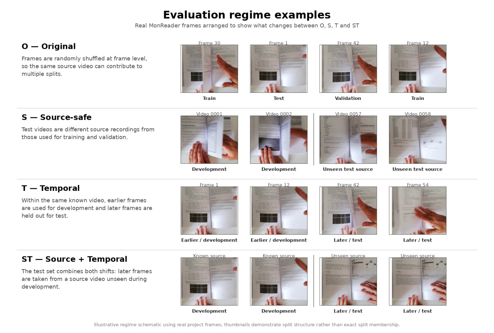
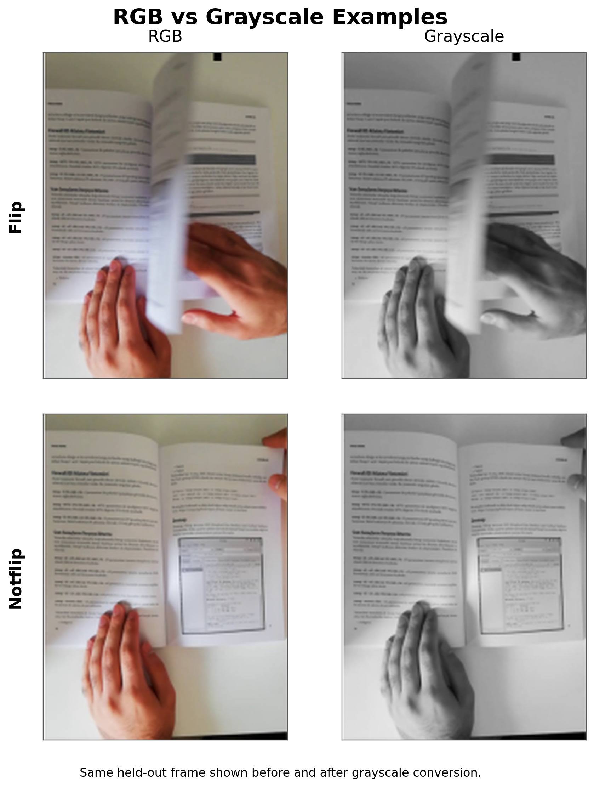
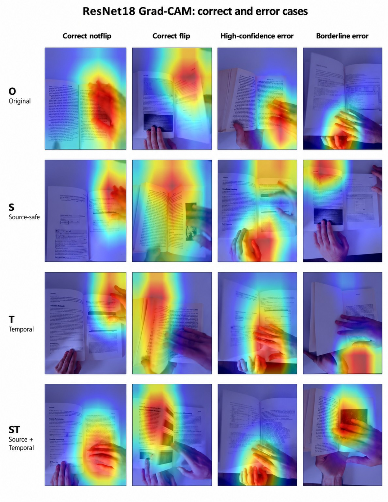

# MonReader — Flip / Not-Flip Image Classification

MonReader is a computer-vision project for classifying video frames as `flip` or `notflip`.

The project evaluates **O (Original), S (Source-safe), T (Temporal), and ST (Source + Temporal)** generalization regimes, compares a tuned Scratch CNN with ImageNet-pretrained ResNet18, tests **RGB vs grayscale**, and uses **Grad-CAM and intermediate activations** to inspect model attention, including possible reliance on hands and page regions.

## Research status and provenance

**Historical evidence and new execution are separate.** The tables and figures below report the originally executed MonReader experiment. They remain reference results until the five `updated_` notebooks are run and their new scores reviewed. The original report's held-out sample counts were O=597, S=610, T=301 and ST=121; a separate later V2 split record uses different source restrictions and test sample counts. See [the reconstruction inventory](docs/RECONSTRUCTION_INVENTORY.md) for the distinction.

A new **progressive temporal proof-of-principle** is drafted in Notebook 04 and is not yet an observed result. The underlying dataset does not establish capture days or actual time intervals.

## Dataset

The original MonReader image dataset is available as [**images.zip — Google Drive**](https://drive.google.com/file/d/1KDQBTbo5deKGCdVV_xIujscn5ImxW4dm/view?usp=sharing). Download and extract the archive into `data/raw/`, preserving the `training/flip`, `training/notflip`, `testing/flip` and `testing/notflip` directories and their original filenames. Alternatively, configure `MONREADER_DATA_ROOT` to point to the extracted dataset root. The image archive is distributed through the dataset link rather than stored in this Git repository.

## Project Workflow

1. **Data audit and split design** — inspect class balance and image filenames, extract environment/video identifiers and frame numbers, reconstruct the source-video structure and chronological order, and construct the O, S, T, and ST evaluation regimes.
2. **CNN model selection** — train and tune the Scratch CNN using the completed Weights & Biases (W&B) Bayesian searches, with validation-based selection.
3. **Model comparison** — compare the selected Scratch CNN with ImageNet-pretrained ResNet18 and test RGB vs grayscale inputs on held-out data.
4. **Generalization and stress testing** — evaluate source and temporal robustness, source-video bootstrap uncertainty, failure patterns, and the separate progressive T/ST proof of principle.
5. **Final analysis and interpretability** — consolidate results and use Grad-CAM and intermediate activations to investigate model behaviour.

## Evaluation Design

All four regimes used the **same original, approximately balanced `flip` / `notflip` dataset** with separate **training, validation, and held-out test sets**. Training fitted the models; validation supported hyperparameter and checkpoint selection; held-out testing assessed the selected models.

| Regime | Meaning | Question answered |
| --- | --- | --- |
| **O** | Original | How accurately does the model classify frames under the dataset's supplied train/test partition? |
| **S** | Source-safe | Can the model classify frames from source videos not seen during training or validation? |
| **T** | Temporal | Can the model classify later frames from known source videos? |
| **ST** | Source + Temporal | Can the model classify later frames from completely unseen source videos? |

**Original (O)** preserves the dataset's supplied training/testing folder membership and takes validation images only from the supplied training folder. Frames are not guaranteed independent across the original partitions: the same reconstructed video source can contribute frames to both training and test. The supplied test set has 597 images.

The regimes progressively test whether apparently strong performance is partly dependent on familiar recordings or temporally similar frames. Because the **O regime does not separate source videos across training and testing**, its performance can appear stronger than the model's ability to generalize. Drops under **S, T, and ST** therefore provide important evidence about robustness under less familiar conditions.

### How Testing Was Performed

Each evaluation regime used separate **training, validation and held-out test** partitions. The training partitions were used to fit the models, and the validation partitions were used to select hyperparameters, training epochs and checkpoints using **Macro F1**. The held-out test partitions were evaluated after model selection, with a fixed **0.50 classification threshold**, and were not used to choose models or tune thresholds.

Testing was performed under four complementary conditions: the original supplied train/test division (**O**), unseen recording sources (**S**), later frames from known recordings (**T**), and later frames from unseen recording sources (**ST**). The Scratch CNN and ImageNet-pretrained ResNet18 were evaluated in each regime. Additional held-out diagnostics included accuracy, precision, recall, confusion-matrix errors, and confidence. Source-video bootstrap resampling (**5,000 repetitions**) produced 95% Macro-F1 confidence intervals, while paired source-video resampling assessed the RGB-versus-grayscale comparison on matching test frames in O and ST. Grad-CAM and intermediate activations were used to examine selected ResNet18 predictions and errors.

### Representative Regime Examples

The figure illustrates what changes between the four regimes, using **real MonReader frames**. It illustrates the design rather than claiming that the particular displayed images prove an exact split assignment.

<p align="center"></p>

### Model Comparison and Key Results

The project compared a **custom convolutional neural network (CNN) trained from scratch** with an **ImageNet-pretrained ResNet18**. The table reports held-out **Macro F1** for both model families, avoiding a second, repetitive ResNet18-only results table.

| Regime | Scratch CNN Macro F1 | ResNet18 Macro F1 |
| --- | ---: | ---: |
| **O** | 0.990 | **0.995** |
| **S** | 0.440 | **0.958** |
| **T** | 0.830 | **0.909** |
| **ST** | 0.791 | **0.877** |

ResNet18 outperformed the Scratch CNN across all four regimes. The contrast was most pronounced in **S**, where the Scratch CNN deteriorated sharply while ResNet18 remained strong. This difference identifies a generalization problem worth investigating; it does not, by itself, identify which visual cues caused the Scratch CNN's weaker result.

ResNet18 itself declined from **0.995 in O to 0.877 in ST**. A near-perfect result under randomly mixed frames therefore did not translate into equally strong performance when both source identity and frame chronology changed.

<p align="center"></p>

## Hyperparameter Optimization

The Scratch CNN was tuned using **Weights & Biases (W&B) Bayesian optimization**, with a separate search for each of O, S, T and ST. The selection objective was **validation Macro F1**, with **30 qualifying trials per regime**. Failed, interrupted, CUDA out-of-memory, non-finite and zero-Macro-F1 attempts were excluded from the qualifying count.

| Hyperparameter | Search space |
| --- | --- |
| Optimizer | Adam, AdamW, SGD, RMSprop |
| Learning rate | log-uniform, `1e-5` to `1e-2` |
| Batch size | integer, 8 to 256 |
| Weight-decay mode | zero or positive |
| Positive weight decay | log-uniform, `1e-6` to `1e-2` |
| Dropout | uniform, 0.0 to 0.5 |
| CNN depth | integer, 1 to 7 convolution blocks |
| Starting filters | integer, 8 to 64 |

Training used a maximum of **50 epochs**, a fixed **0.50 decision threshold**, validation-based checkpoint selection, and early stopping. New trials use early-stopping **patience = 4** and validation batch size at most **32**. Independent scratch models are initialized and tuned separately for O, S, T and ST. Each ResNet18 model likewise starts independently from ImageNet-pretrained weights for that regime; models are not transferred sequentially from O to S to T to ST.

## Robustness and Uncertainty

Individual frames from the same video are not fully independent: neighbouring frames can be visually very similar. Treating every frame as an unrelated observation could therefore make the model's performance appear more certain than it really is.

To account for this, **source-video bootstrapping** was used. Instead of repeatedly resampling individual frames, the analysis repeatedly resampled entire source videos and recalculated Macro F1. The resulting **95% confidence intervals** summarize variation under source-level resampling.

ResNet18, the stronger model, achieved:

| Regime | ResNet18 Macro F1 | 95% source-video bootstrap CI |
| --- | ---: | --- |
| **O** | 0.995 | **[0.986, 1.000]** |
| **S** | 0.958 | **[0.910, 0.993]** |
| **T** | 0.909 | **[0.866, 0.947]** |
| **ST** | 0.877 | **[0.748, 0.972]** |

The scores decrease in the more demanding regimes, while the particularly wide **ST interval** reflects greater uncertainty across the resampled source-video population when source and temporal restrictions are combined.

## RGB vs Grayscale

A controlled **Scratch CNN** ablation compared RGB and grayscale versions of the same held-out images to test whether colour information materially influenced classification.

| Regime | RGB Macro F1 | Grayscale Macro F1 | Δ Grayscale − RGB |
| --- | ---: | ---: | ---: |
| **O** | 0.990 | **0.997** | +0.007 |
| **ST** | **0.791** | 0.690 | −0.101 |

Although grayscale performed slightly better in **O** and worse in **ST**, the recorded paired source-video bootstrap intervals included zero in both regimes. The analysis therefore did **not provide sufficient evidence that colour was a consistent or meaningful driver of performance**.

The image pairs below show the **same held-out `flip` and `notflip` frames before and after grayscale conversion**.

<p align="center"></p>

## Grad-CAM and Interpretability

Grad-CAM was applied to the **ImageNet-pretrained ResNet18** to examine which image regions contributed most strongly to its predictions.

A fixed set of **21 cases** was chosen before visual inspection to cover confident correct predictions, borderline decisions, and errors across O, S, T, and ST. The clean **4 × 4 matrix** presents **16 representative overlays**: rows correspond to O/S/T/ST and columns to correct `notflip`, correct `flip`, high-confidence error, and borderline error. The remaining selected cases belong to the complete 21-case analysis.

<p align="center"></p>

Across the selected cases:

- **Correct `flip` predictions** typically emphasized raised or curved page surfaces, page edges/folds, and nearby hand–page interactions.
- **Correct `notflip` predictions** more often concentrated on a hand resting against the page and an adjacent page boundary.
- **High-confidence errors** frequently concentrated on hands or high-contrast page regions despite the prediction being wrong.
- **Borderline errors** tended to show more diffuse or displaced attention across hands, page content, or margins.

The overlays indicate associations between predictions and visible regions; they are **not causal proof** that a particular feature was responsible for a decision. Intermediate-layer activations provide an additional view of how the ResNet18 representations change through the network and are documented in Notebook 05.

## Failure Analysis

Failure analysis was performed on **ResNet18**, the stronger final reference model, because it outperformed the Scratch CNN across all four evaluation regimes.

| Regime | Errors | Error Rate | False Positives | False Negatives | High-Confidence Errors |
| --- | ---: | ---: | ---: | ---: | ---: |
| **O** | 3 | 0.5% | 0 | 3 | 33% |
| **S** | 25 | 4.1% | 12 | 13 | 32% |
| **T** | 27 | 9.0% | 0 | 27 | 52% |
| **ST** | 14 | 11.6% | 0 | 14 | 79% |

In **T and ST, every recorded error was a false negative**: the model missed real page flips but did not predict flips for frames labelled `notflip`. Under these conditions, the model made more missed-flip errors rather than false alarms.

For deployment, the main risk is therefore **missed page turns**, and many of these errors occur even when the model is highly confident. A simple confidence cutoff is not a reliable safeguard. Lowering the `flip` decision threshold could recover some missed flips but may also introduce false positives; that trade-off would need to be evaluated using validation data and checked separately on held-out test data.

## Progressive temporal updating — new experiment (pending execution)

The updated fourth notebook contains a separate, executable proof of principle using two progressively fine-tuned pretrained ResNet18 models. The T model is updated using increasing prefixes of familiar recordings; ST uses early frames from known sources and evaluates chronological positions within never-seen sources. At **25%, 50%, 75% and 90%** historical coverage, it computes both overall remaining-future Macro F1 and **three-frame horizon-window** Macro F1/flip recall, with minimum class and source support. The same final 10% of each source is also used for a matched-future comparison. The experiment **does not** demonstrate future-event forecasting, elapsed-time drift, or automatic online learning; supervised updates require new labels.

**Results and plots will be added here only after the revised notebooks have been executed and reviewed.**

## Conclusion and Recommendation

**ResNet18 was the strongest model** across all four regimes, but its Macro F1 declined as source and temporal generalization became more demanding.

The main practical limitation is not simply a lower score: under T and ST, errors were entirely false negatives and many occurred with high confidence. This means the classifier can miss genuine page turns without appearing uncertain.

The model is promising for MonReader, but **should not yet be treated as deployment-ready without further testing on independent unseen recordings and targeted work to reduce confident false negatives**.

## Limitations and Next Steps

The dataset is relatively small and comes from a limited number of reconstructed source recordings, so measured performance may not cover the full range of books, users, lighting conditions, camera angles, and page-turning styles encountered in practice.

Next priorities are broader testing on unseen recording sources, investigation of high-confidence false negatives, and assessment of robustness when the recording conditions differ from those represented in the present dataset.

## Reproducing the Project

The five notebooks form an executable technical report covering data preparation, model development, testing, robustness analysis and interpretability. **Running them in order with the original dataset generates a **fresh, auditable run**. Minor differences from the historic reported scores are possible because model initialization, trial sequences and execution environments differ. A Weights & Biases account is required for Bayesian hyperparameter optimization.**

1. Set up Python 3.11 or newer and install the dependencies:
   ```bash
   python -m pip install -r requirements.txt
   ```
   Install the PyTorch build appropriate for your CPU or GPU if needed.
2. [Download the original MonReader dataset](https://drive.google.com/file/d/1KDQBTbo5deKGCdVV_xIujscn5ImxW4dm/view?usp=sharing) and extract it into `data/raw/`, or set `MONREADER_DATA_ROOT` to the extracted dataset location.
3. Sign in to [Weights & Biases](https://wandb.ai/), run `wandb login`, and configure `MONREADER_WANDB_PROJECT` and, if applicable, `MONREADER_WANDB_ENTITY` for your account.
4. Run notebooks **01 → 02 → 03 → 04 → 05** from the project root. Models, predictions, metrics, figures and other generated outputs are saved locally.

**Evaluation metric:** Macro F1 is the primary measure used for hyperparameter optimization, checkpoint selection and held-out comparison.

## Repository Guide

The project consists of five `updated_` research notebooks, reusable Python source code in `src/`, a `requirements.txt` environment specification, and the four figures displayed in this report. Downloaded images, trained model checkpoints, W&B logs and generated experiment outputs are kept separately from tracked project code.

### Notebook Guide

| Notebook | Purpose |
| --- | --- |
| `updated_01_data_and_splits.ipynb` | Explore the dataset, reconstruct video sources and frame order, and create the O/S/T/ST evaluation partitions. |
| `updated_02_cnn_selection.ipynb` | Train Scratch CNNs and perform Bayesian hyperparameter optimization using validation Macro F1. |
| `updated_03_model_comparison.ipynb` | Fine-tune ResNet18, compare held-out performance and evaluate RGB versus grayscale. |
| `updated_04_generalization_and_stress_tests.ipynb` | Quantify source-video uncertainty, analyze errors, and evaluate progressive T/ST coverage with future-horizon windows. |
| `updated_05_final_analysis.ipynb` | Examine representative predictions using Grad-CAM and intermediate activations, and summarize findings. |
