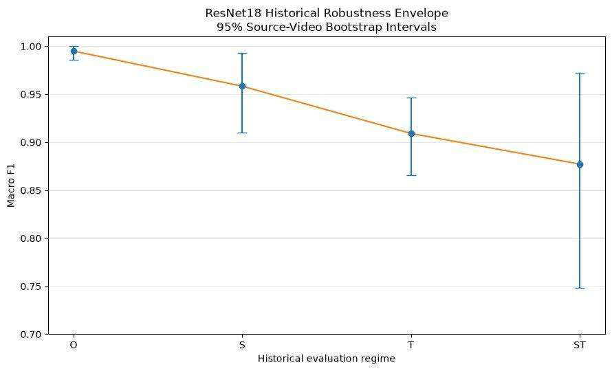
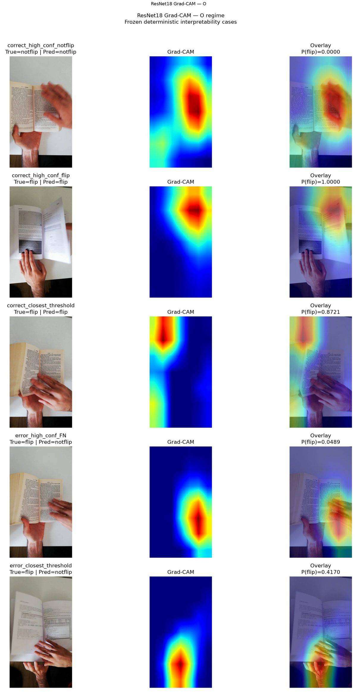
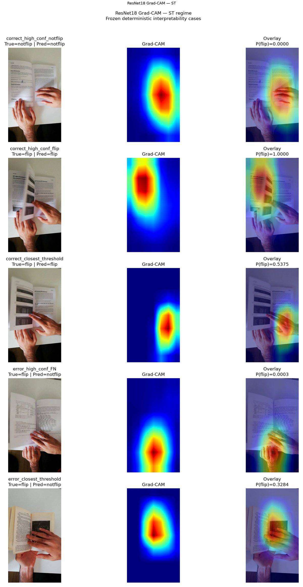

# MonReader — Flip / Not-Flip Image Classification

MonReader is a computer-vision project for classifying a video frame as **`flip`** or **`notflip`**.

This repository contains two intentionally separated scientific tracks:

1. **Current V2 rebuild — authoritative.**  
   The prospectively frozen train/test-only protocol on `main`.
2. **Historical five-notebook submission — reproducibility record.**  
   A cleaned, reviewer-ready reconstruction of the original O/S/T/ST analysis, W&B scratch-CNN selection, ResNet18 comparison, robustness analysis, uncertainty, Grad-CAM, and final interpretation.

The historical notebook package is explicitly labelled **`HISTORICAL_NON_AUTHORITATIVE_PRE_V2`** so its validation/Bayesian methodology cannot be confused with the current V2 protocol.

---

## Submission package

Start here if you are reviewing the original MonReader project deliverable:

- [Submission guide](submission/README.md)
- [01 — Data audit and splits](submission/notebooks/01_data_and_splits.ipynb)
- [02 — Scratch CNN selection + portable W&B](submission/notebooks/02_cnn_selection.ipynb)
- [03 — Model / color comparison](submission/notebooks/03_model_comparison.ipynb)
- [04 — Generalization and stress tests](submission/notebooks/04_generalization_and_stress_tests.ipynb)
- [05 — Final analysis + Grad-CAM](submission/notebooks/05_final_analysis.ipynb)
- [Technical report](reports/TECHNICAL_REPORT.md)
- [Business recommendations](reports/BUSINESS_RECOMMENDATIONS.md)

The successful numerical outputs are committed under [`submission/results/`](submission/results/). Final figures and Grad-CAM panels are committed under [`submission/assets/figures/final/`](submission/assets/figures/final/).

---

## Historical results snapshot

The historical ResNet18 analysis produced:

| Regime | Macro F1 | Source-video 95% CI | Main question |
|---|---:|---:|---|
| O | **0.994969** | [0.986128, 1.000000] | Nominal supplied split |
| S | **0.958387** | [0.909802, 0.993352] | Unseen source-video stress |
| T | **0.909140** | [0.865657, 0.946739] | Later-frame temporal stress |
| ST | **0.877246** | [0.747988, 0.972281] | Combined source + temporal stress |



The principal historical lesson is that near-perfect nominal performance does **not** imply equivalent performance under source and temporal shift.

---

## Grad-CAM and interpretability

Notebook 5 contains 21 deterministic interpretability cases selected before visual inspection.

- 21/21 Grad-CAM maps generated;
- 0 degenerate maps;
- frozen class decisions preserved;
- 84 intermediate activation maps generated across four fixed ResNet18 stages;
- no manual channel or case cherry-picking.

Example regime panels are committed directly in the repository:





Grad-CAM is treated as a diagnostic association with the model score, not as causal evidence.

---

## Portable execution

Install the historical submission dependencies:

```bash
python -m pip install -r submission/requirements.txt
jupyter notebook
```

Open the notebooks in numerical order.

### Report mode — default

No W&B account, raw dataset, GPU, or original sweep ID is required to review the completed work. The notebooks use committed CSV snapshots and verified figures.

### Optional local dataset

```bash
MONREADER_DATA_ROOT=/path/to/monreader/data
```

### Optional W&B integration

W&B is disabled by default and configured only through environment variables.

```bash
MONREADER_ENABLE_WANDB=1
MONREADER_WANDB_PROJECT=my-monreader-project
MONREADER_WANDB_ENTITY=my-team       # optional
WANDB_API_KEY=...                    # or run: wandb login
WANDB_MODE=online
```

New sweep creation and agent execution have **separate opt-in gates**:

```bash
MONREADER_CREATE_NEW_SWEEP=1
MONREADER_RUN_WANDB_AGENT=1
MONREADER_WANDB_AGENT_COUNT=1
```

No W&B credential, username, entity, project owner, or machine-specific path is stored in the notebooks.

---

## Current V2 — authoritative

The V2 rebuild uses a frozen train/test-only protocol and remains the scientific source of truth for current conclusions.

### Frozen scratch champions

| Regime | Champion | F1 |
|---|---:|---:|
| O | C14 | **0.9983** |
| S | C18 | **0.8196** |
| T | C06 | **0.8800** |
| ST | C07 | **0.7040** |

### Fixed ResNet18 comparator

| Regime | Scratch champion F1 | ResNet18 F1 | ΔF1 |
|---|---:|---:|---:|
| O | 0.9983 | 0.9931 | -0.0052 |
| S | 0.8196 | 0.7807 | -0.0390 |
| T | 0.8800 | 0.8807 | +0.0007 |
| ST | 0.7040 | 0.7196 | +0.0156 |

Historical notebook numbers must not replace these V2 results.

---

## Repository layout

```text
submission/
├── notebooks/                    # cleaned five-notebook historical workflow
├── results/                      # verified CSV snapshots
├── assets/figures/final/         # final report + Grad-CAM figures
├── src/repro.py                  # portable paths, snapshot helpers, W&B gates
├── .env.example
├── requirements.txt
└── README.md

reports/
├── TECHNICAL_REPORT.md
└── BUSINESS_RECOMMENDATIONS.md

configs/, manifests/, protocol/, outputs/
└── current V2 authoritative research artifacts
```

---

## Core methodological conclusion

> **MonReader should be evaluated under source-aware and temporally aware conditions before any deployment claim is made.**

The nominal split shows what the classifier can achieve under favourable conditions. The source/temporal regimes expose the robustness and uncertainty that a single nominal score can hide.
