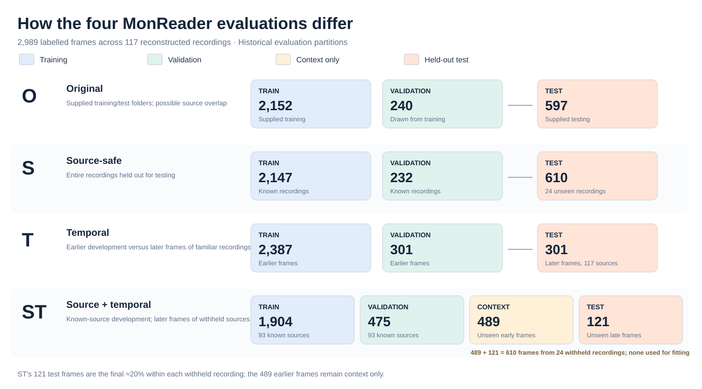
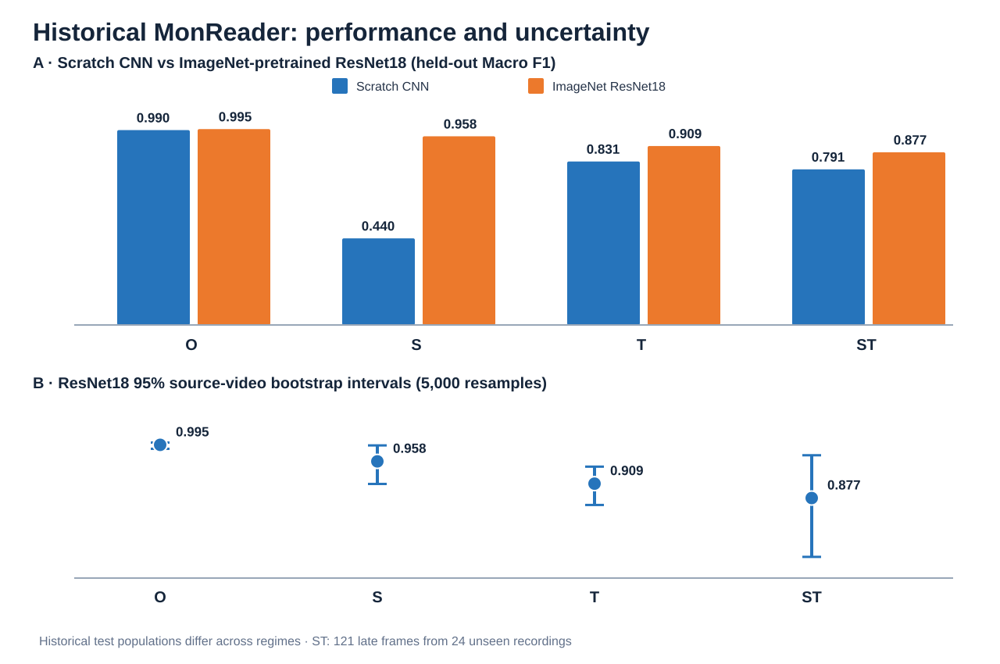
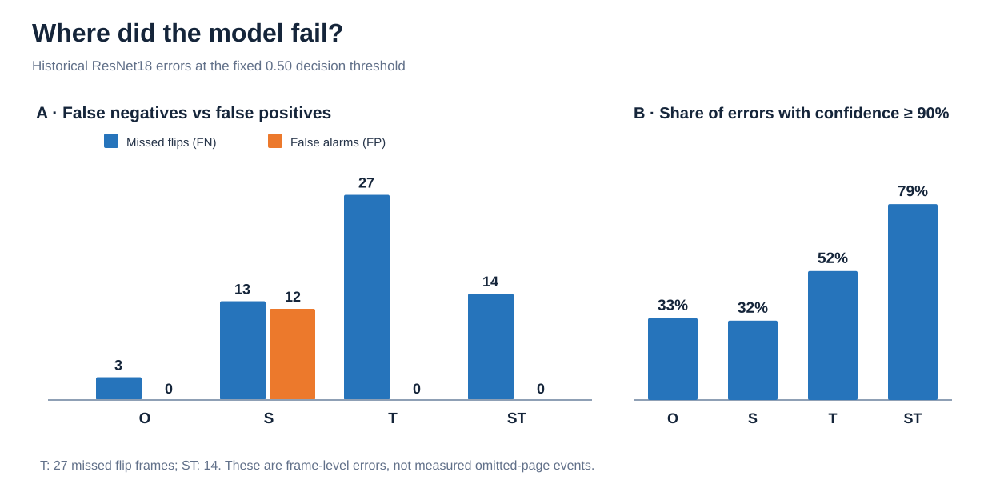
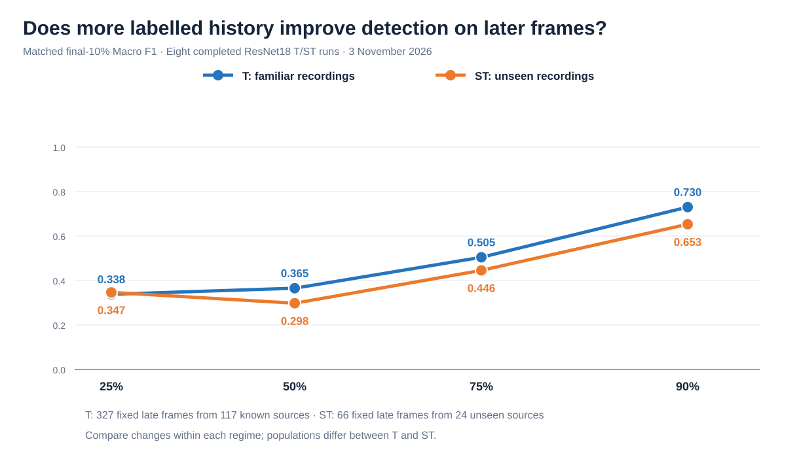

# MonReader — Robust Page-Turn Classification

**Research question:** Can a model detect page flips reliably in later frames and previously unseen recordings—not only in the original dataset split? We compared a tuned Scratch CNN with ImageNet-pretrained ResNet18, investigated failures and evaluated whether more labelled history improved later-frame predictions. **Headline:** near-perfect nominal performance did not guarantee reliable page-turn detection under source and temporal shift.

## Dataset and evaluation design

The dataset contains **2,989 labelled `flip`/`notflip` frames** from **117 reconstructed recordings** ([source dataset](https://drive.google.com/file/d/1KDQBTbo5deKGCdVV_xIujscn5ImxW4dm/view?usp=sharing)). The historical protocols were **O** (supplied split), **S** (unseen sources), **T** (later frames of familiar sources) and **ST** (later frames of unseen sources). Frame chronology comes from filenames rather than verified capture timestamps.

**Why did historical ST test only 121 images?** The **24 entirely withheld recordings** contained **610 frames**. Within each source, the split reserved approximately the **earlier 80% (489 frames)** as *context only* and scored approximately the **last 20% (121 frames)** as the held-out test. **None of the 610 frames was used to train or validate ST.** The earlier 489 were intentionally *not scored* in that historical late-only test. This assesses later-frame performance on sources the model had never seen, rather than selectively discarding difficult examples. The separate progressive ST experiment uses its own evaluation suffix and must not be confused with the historical 121-frame benchmark.

## Model selection — historical methodology

The Scratch CNN was tuned using **four independent W&B Bayesian sweeps**, one for each regime, with **30 qualifying trials per regime (120 total)**. Models were selected by **validation Macro F1**, using early stopping (maximum 50 epochs) and a frozen **0.50** classification threshold. ResNet18 started independently from ImageNet-pretrained weights for each regime. These historical outcomes are accepted archived results; the updated notebooks do not rerun them by default.

| Tuned hyperparameter | Historical Bayesian search space |
|---|---|
| Optimizer | Adam, AdamW, SGD, RMSprop |
| Learning rate | Log-uniform: `1e-5`–`1e-2` |
| Batch size | Integer: 8–256 |
| Weight decay mode | Zero or positive |
| Positive weight decay | Log-uniform: `1e-6`–`1e-2` |
| Dropout | Uniform: 0.0–0.5 |
| CNN depth | 1–7 convolution blocks |
| Starting filters | Integer: 8–64 |

## Historical results — performance and uncertainty

| Regime | Scratch CNN Macro F1 | ResNet18 Macro F1 |
|---|---:|---:|
| O | 0.990 | **0.995** |
| S | 0.440 | **0.958** |
| T | 0.831 | **0.909** |
| ST | 0.791 | **0.877** |

**Test:** Would performance weaken when moving away from the familiar supplied split, and would pretraining help? **Observed:** ResNet18 outperformed the Scratch CNN throughout, especially S (0.958 versus 0.440). ResNet18 itself declined from **0.995 (O)** to **0.877 (ST)**, broadly consistent with the expected generalization difficulty. Pretrained representations may help, but the mechanism was not isolated experimentally.

Source-video bootstrap intervals (5,000 resamples) were used because nearby frames are correlated. The historical ST **95% interval was approximately 0.747–0.972**, substantially wider than O. Because each regime uses a different test population, the score gaps are descriptive, not controlled causal effects. **Business implication:** never approve a release from the nominal O result alone; require unseen-recording validation with uncertainty.

## Failure analysis — why Macro F1 is not enough

**Test:** Which errors matter to a hands-free reader, and does model confidence reveal them? **Observed:** T recorded **27 missed flip frames and no false alarms**; ST recorded **14 missed flip frames and no false alarms**. The model assigned at least **90% confidence to 52% of T errors and 79% of ST errors**. Under S, both false negatives (13) and false positives (12) occurred. Error counts are **per frame, not measured skipped pages**.

This false-negative concentration was observed rather than guaranteed by the design. Recording variation and the fixed decision threshold are plausible contributors, not demonstrated causes. **Business implication:** prioritize flip recall, missed page-turn *events*, per-recording failure rates and sensible retry/fallback behavior—not overall accuracy or model confidence alone.

## Grad-CAM — what visual regions attracted attention?

Correct and incorrect Grad-CAM examples highlight **hands, page edges and other page regions**. They motivate controlled tests of occlusion, lighting and camera position, but do **not** prove that any region caused the model's decision. Detailed activation analysis remains in Notebook 05, outside this concise report.

## Does more labelled history improve page-flip detection on later frames?

A **separate, completed eight-run ResNet18 study (3 November 2026)** updated the T and ST models after **25%, 50%, 75% and 90%** observed chronological coverage. The primary comparison uses the **same final 10% of frames within each regime at every checkpoint**, avoiding the changing-test-population problem: **327 frames/117 familiar sources in T**, and **66 frames/24 withheld sources in ST**. The withheld ST sources never entered ST training or validation.

| Fixed late-frame cohort | 25% | 50% | 75% | 90% | Missed-flip rate at 90% |
|---|---:|---:|---:|---:|---:|
| T Macro F1 | 0.338 | 0.365 | 0.505 | **0.730** | **47.1%** (80/170) |
| ST Macro F1 | 0.347 | 0.298 | 0.446 | **0.653** | **58.1%** (18/31) |

**Missed-flip rate** = false negatives ÷ actual `flip` frames in the fixed late-frame cohort (equivalently, 1 − flip recall). These proportions describe **missed flip frames, not missed page-turn events**; T and ST use different evaluation cohorts.

**Expectation:** more relevant labelled history might help, but improvement need not be monotonic. **Observed:** final matched-cohort Macro F1 was higher at 90% than at 25% in both regimes, but the ST score **dipped at 50%**. At 90%, flip recall was only **0.529 (T)** and **0.419 (ST)**. This suggests that planned supervised updates merit further investigation; it does **not** establish that additional data caused the improvements, that online learning occurred, or that the model is deployment-ready. Cross-regime T/ST scores are not a controlled head-to-head comparison.

## Business decision and next steps

**Recommendation: controlled evaluation, not unrestricted deployment.** A missed page-turn *frame* could contribute to a skipped-page experience, but this study did not measure page-level omissions, operating cost or customer outcomes. Next, evaluate independent timestamped recordings with actual page-turn event labels; predefine tolerable missed-event rates, intervention rates and latency; compare frozen classification against temporal aggregation; and verify performance on untouched users, devices and recording conditions. The RGB/grayscale analysis supplied no convincing deployment benefit from removing color.

## Reproduce or inspect

Install dependencies with `python -m pip install -r requirements.txt`, supply the [original dataset](https://drive.google.com/file/d/1KDQBTbo5deKGCdVV_xIujscn5ImxW4dm/view?usp=sharing) under `data/raw/` (or set `MONREADER_DATA_ROOT`), then run [01 — data and splits](updated_01_data_and_splits.ipynb) → [02 — CNN tuning](updated_02_cnn_selection.ipynb) → [03 — model comparison](updated_03_model_comparison.ipynb) → [04 — generalization and progressive study](updated_04_generalization_and_stress_tests.ipynb) → [05 — final analysis](updated_05_final_analysis.ipynb) in order. Notebooks 02–05 default to reporting preserved historical/progressive CSV results, **not new W&B sweeps or GPU runs**. Notebook 01 still requires the image dataset to reconstruct the manifest and splits. Optional fresh training must be enabled explicitly. See the [completed eight-run experiment receipt](results/progressive_study_provenance.md) and [W&B project](https://forge.coreweave.com/wandb/nickthegreek/monreader-progressive-temporal).
