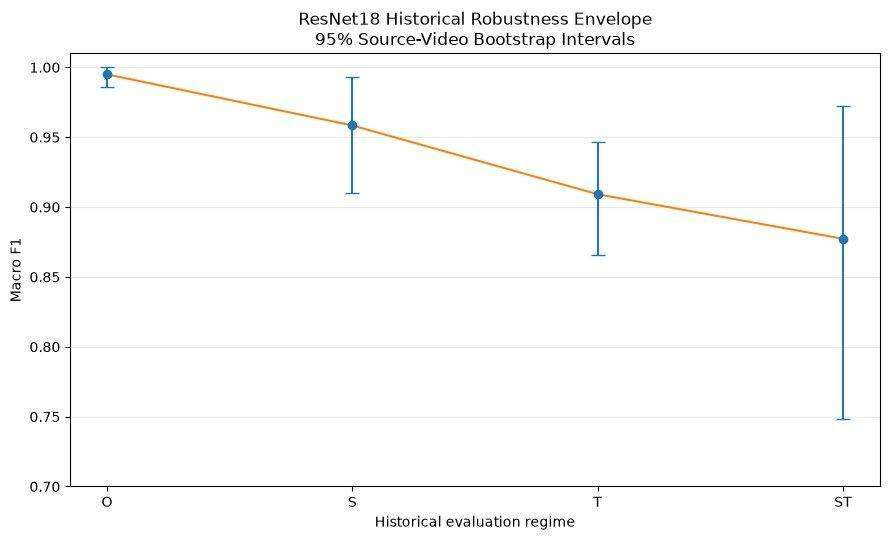
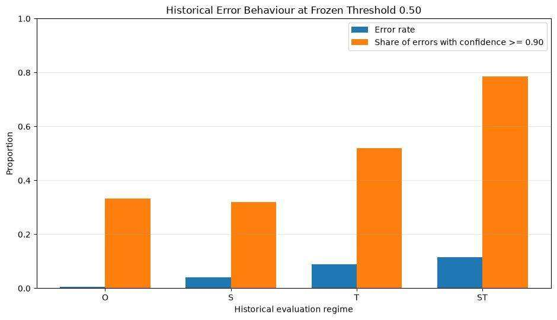
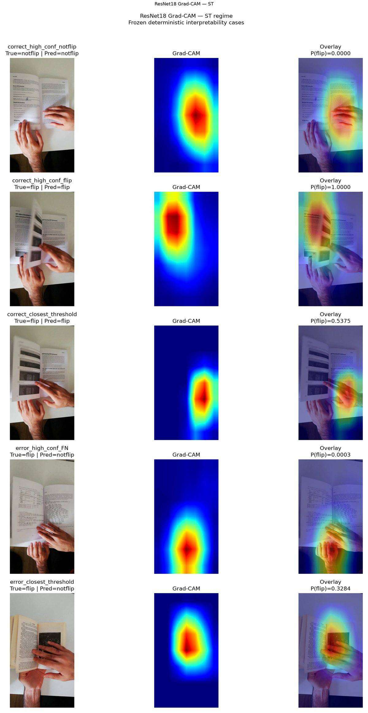

# MonReader Business Recommendations

## Executive recommendation

MonReader is promising, but **do not base a production-readiness decision on the nominal O score alone**.

The historical analysis reaches near-perfect O performance while performance decreases under source and temporal stress. The current V2 rebuild was created specifically to enforce stricter evaluation governance.

The recommended business posture is:

> **controlled pilot → new-source data collection → temporal monitoring → predeclared acceptance criteria → scale only after robustness is demonstrated.**

---

## 1. Make unseen-source performance the deployment gate

Historical ResNet18 Macro F1:

| Regime | Macro F1 |
|---|---:|
| O | 0.995 |
| S | 0.958 |
| T | 0.909 |
| ST | 0.877 |

The gap between O and the stress regimes is the clearest business risk: a system that looks excellent on familiar recordings can underperform when the recording source changes.

### Recommendation

Require a pilot benchmark containing genuinely new:

- users;
- devices/cameras;
- desks/backgrounds;
- lighting conditions;
- page materials;
- camera positions;
- handling styles.

### Business implication

Source-aware testing reduces the chance that a high laboratory score turns into customer-facing support cost after deployment.

---

## 2. Treat missed flips as the primary operational failure

False negatives dominate the historical T/ST failure pattern.

### Recommendation

Define a business-level false-negative tolerance before pilot launch.

If a missed flip is costly:

- use retry/review behaviour;
- monitor misses by source/session;
- test simple temporal aggregation on development data;
- avoid relying on aggregate accuracy alone.

### Business implication

A classifier can maintain strong overall metrics while still missing the event that the product actually needs to detect.

---

## 3. Use temporal information in the product architecture

A page flip is an event over time, yet the historical classifier operates on one frame at a time.

### Recommendation

Evaluate a lightweight sequence layer prospectively:

- probability smoothing;
- rolling majority/median voting;
- hysteresis around state transitions;
- explicit transition detection.

Do not tune this layer on the final deployment benchmark.

### Business implication

Temporal context may reduce isolated confident mistakes without requiring a dramatically larger vision model.

---

## 4. Spend new annotation budget on stress conditions

The O regime is already close to ceiling.

### Recommendation

Prioritize new data from:

- previously unseen source videos;
- later portions of videos;
- partial occlusion;
- difficult lighting;
- different hands/arms;
- ambiguous page movement;
- camera-angle changes;
- unusual backgrounds.

### Business implication

Another thousand easy frames from familiar conditions is likely to have less value than a smaller targeted set that represents actual deployment variation.

---

## 5. Monitor confidence, but never equate it with correctness

In the historical ST evaluation, a large fraction of errors were made with ≥0.90 confidence.

### Recommendation

During a pilot, log probability distributions by session/source and flag:

- repeated high-confidence misses;
- sustained low-confidence periods;
- sudden confidence-distribution shifts;
- sources contributing disproportionate failures.

### Business implication

Confident errors are dangerous because the system may fail silently.

---

## 6. Use Grad-CAM for debugging, not customer-facing explainability claims

The project generated reproducible Grad-CAM heatmaps for 21 frozen cases.

### Recommendation

Use Grad-CAM internally to:

- inspect suspicious failure cases;
- identify recurring visual regions;
- generate hypotheses for controlled ablations;
- support dataset-quality reviews.

Do not market the model as causally “explainable” solely because heatmaps are available.

---

## 7. Preserve experiment governance

The project’s evolution shows why governance matters.

### Recommendation

For future production experiments:

1. freeze the evaluation population before testing;
2. freeze model configuration and threshold before final benchmark access;
3. record every candidate configuration;
4. report source/video-level uncertainty;
5. prohibit error-driven retuning after the benchmark is opened;
6. retain reproducible model/checkpoint provenance.

### Business implication

This reduces the risk of a model that looks strong in a presentation but fails to reproduce when deployed.

---

## 8. Pilot acceptance criteria

Before expanding beyond a controlled pilot, require:

- predeclared source-safe and temporal benchmarks;
- source-video confidence intervals;
- acceptable false-negative rate;
- stable performance across new sources;
- no single source dominating the failure count;
- documented fallback behaviour;
- versioned model/threshold provenance;
- monitoring for confidence and source drift.

---

## 9. Recommended roadmap

### Phase A — controlled validation
Deploy the frozen current system to a limited set of new sources and collect evaluation data without changing the benchmark.

### Phase B — temporal decision layer
Test a simple sequence-aware post-processor on development data.

### Phase C — targeted robustness improvement
Use repeatable failure mechanisms—not isolated anecdotes—to choose augmentations or new data collection.

### Phase D — monitored pilot
Run with source-level metrics, confidence logging, and operational fallback.

### Phase E — scale
Expand only after source-safe and temporal performance remain within predeclared acceptance limits.

---

## Final business conclusion

MonReader’s opportunity is not “a model that scores almost 100% on a nominal split.”

The valuable product is a system that **reliably detects page-flip events across new users, sources, and time**.

The next investment should therefore be robustness validation and controlled deployment—not unconstrained tuning of a nominal score that is already saturated.
