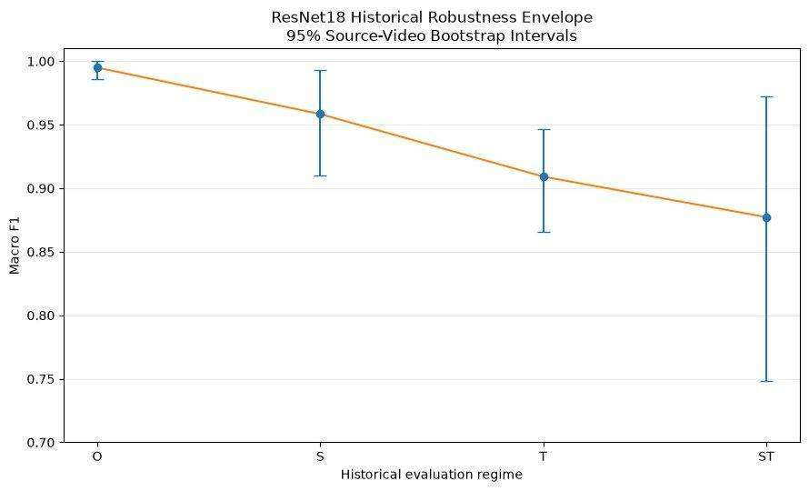
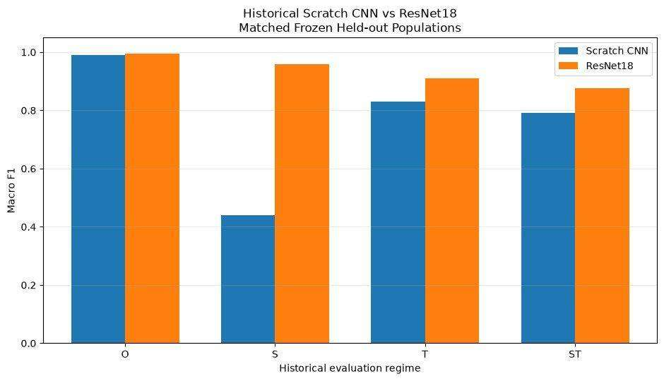
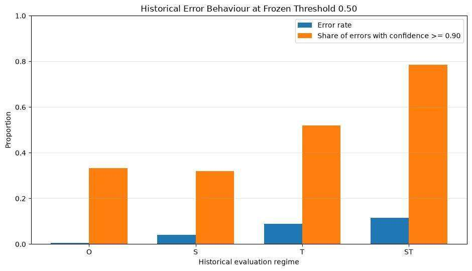
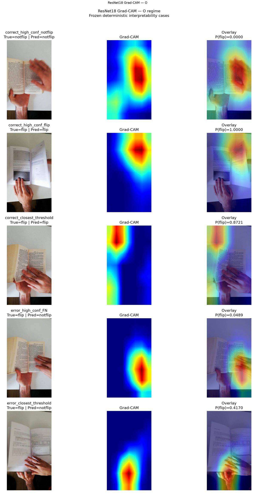
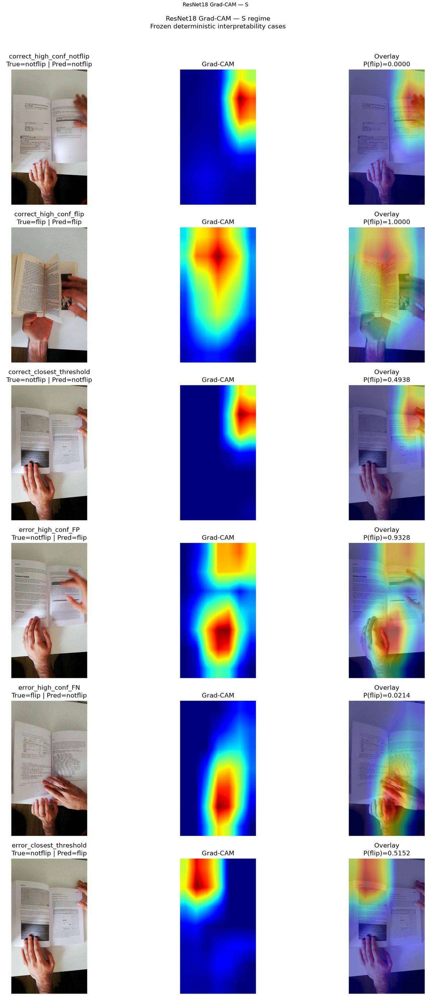
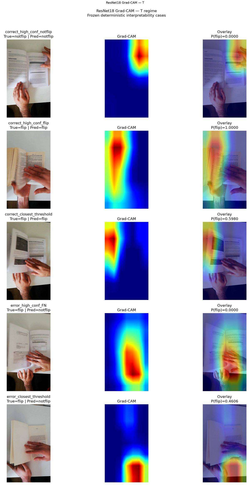
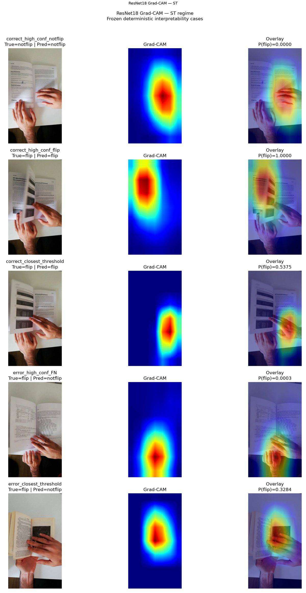
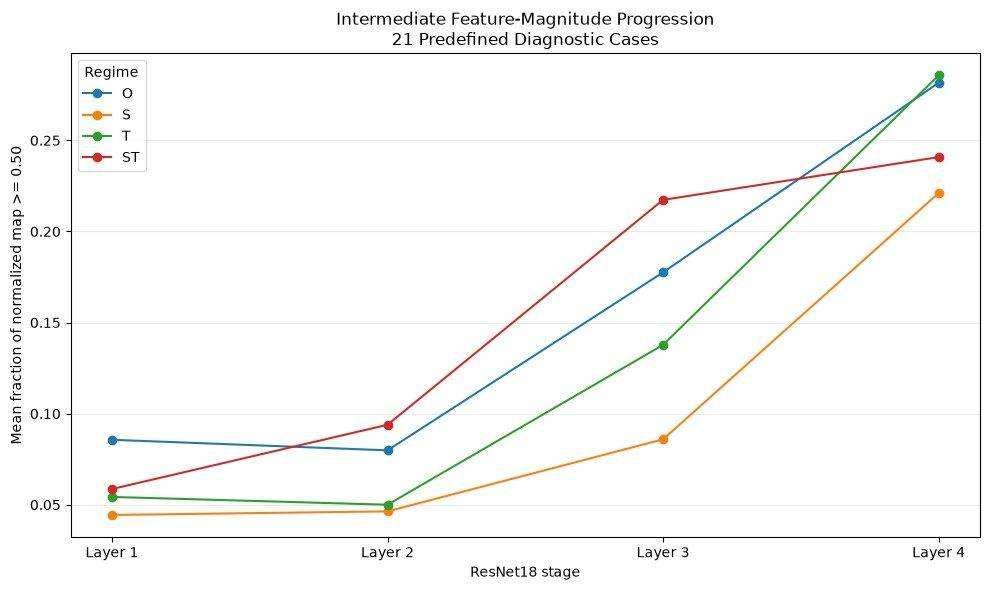

# MonReader Technical Report

## Executive summary

MonReader is a binary computer-vision project that classifies individual video frames as **`flip`** or **`notflip`**. The historical five-notebook analysis revealed the project’s central technical risk: **nominal frame-level performance can look almost perfect while robustness falls under source and temporal shift**.

The cleaned submission package preserves that historical experiment faithfully while separating it from the current V2 protocol, which is scientifically authoritative.

The historical ResNet18 results were:

| Regime | Macro F1 | Source-video 95% CI | Balanced accuracy | MCC |
|---|---:|---:|---:|---:|
| O | **0.994969** | [0.986128, 1.000000] | 0.994828 | 0.989989 |
| S | **0.958387** | [0.909802, 0.993352] | 0.958202 | 0.916780 |
| T | **0.909140** | [0.865657, 0.946739] | 0.908163 | 0.833399 |
| ST | **0.877246** | [0.747988, 0.972281] | 0.867925 | 0.781163 |

---

## 1. Problem and evaluation risk

The task is deceptively simple: identify whether a single frame contains a page-flip event.

The dataset, however, consists of frames extracted from videos. Adjacent frames from the same source video are correlated in content, lighting, camera viewpoint, user, background, and page state. A train/test split that mixes frames from the same videos can therefore overstate generalization.

The historical workflow addressed this by defining four evaluation regimes rather than relying on one nominal split.

---

## 2. Historical data and split design

The audited historical dataset contained **2,989 frames from 117 source videos**.

| Regime | Train | Validation | Context | Test | Test source videos | Purpose |
|---|---:|---:|---:|---:|---:|---|
| O | 2,152 | 240 | 0 | 597 | 115 | supplied / source-joint benchmark |
| S | 2,147 | 232 | 0 | 610 | 24 | held-out source-video stress |
| T | 2,387 | 301 | 0 | 301 | 117 | later-frame stress |
| ST | 1,904 | 475 | 489 | 121 | 24 | source + temporal stress |

These populations are not interchangeable. Cross-regime score changes are therefore **descriptive robustness comparisons**, not isolated causal effects.

---

## 3. Historical scratch CNN and W&B selection

The historical primary scratch model was tuned with independent Bayesian W&B sweeps for O/S/T/ST.

The search space covered:

- Adam / AdamW / SGD / RMSprop;
- learning rate from `1e-5` to `1e-2`;
- batch size 8–256;
- optional positive weight decay `1e-6` to `1e-2`;
- dropout 0.0–0.5;
- depth 1–7 convolutional blocks;
- starting filters 8–64.

Each regime reached **30 qualifying completed runs** after explicit exclusion of invalid, OOM, or zero-F1 runs.

A later audit corrected stale historical winner identities for T and ST. The submission notebooks use those corrected winners throughout.

Historical tuned-scratch held-out Macro F1:

| Regime | Macro F1 |
|---|---:|
| O | 0.9899 |
| S | 0.4400 |
| T | 0.8305 |
| ST | 0.7906 |

The S collapse was the clearest evidence that the nominal O result was not a sufficient robustness estimate.

### Portable W&B implementation

The submission package no longer assumes the original W&B account.

- project and entity come from environment variables;
- authentication comes from `WANDB_API_KEY` or local `wandb login`;
- sweep creation is disabled unless `MONREADER_CREATE_NEW_SWEEP=1`;
- agent execution is separately disabled unless `MONREADER_RUN_WANDB_AGENT=1`;
- no sweep ID or credential is embedded in the notebooks.

This makes the notebook reproducible for another user while keeping ordinary `Run All` behaviour safe.

---

## 4. ResNet18 model-family comparison

The historical ImageNet-pretrained ResNet18 was evaluated on the same frozen populations.

| Regime | Scratch Macro F1 | ResNet18 Macro F1 | Δ ResNet − Scratch |
|---|---:|---:|---:|
| O | 0.9899 | 0.9950 | +0.0050 |
| S | 0.4400 | 0.9584 | +0.5184 |
| T | 0.8305 | 0.9091 | +0.0786 |
| ST | 0.7906 | 0.8772 | +0.0867 |

The historical advantage of pretrained ResNet18 was small under O but large under source shift, especially S.

This is a historical matched comparison only; it does not change the current V2 champions.

---

## 5. Generalization and uncertainty

Source-video bootstrap intervals are the primary uncertainty measure because individual frames within one video are not independent.

ST has the widest interval because it contains only **24 independent test source videos and 121 frames**.

The historical ordering O → S → T → ST is therefore best read as a robustness envelope:

- O demonstrates near-ceiling nominal fit;
- S tests unseen source videos;
- T tests later frames of known videos;
- ST combines both stresses.

No cross-regime difference should be described as a clean causal effect.

---

## 6. Failure analysis

Historical ResNet18 errors were:

| Regime | Errors | Error rate | FP | FN | High-confidence error share ≥ 0.90 |
|---|---:|---:|---:|---:|---:|
| O | 3 | 0.0050 | 0 | 3 | 0.333 |
| S | 25 | 0.0410 | 12 | 13 | 0.320 |
| T | 27 | 0.0897 | 0 | 27 | 0.519 |
| ST | 14 | 0.1157 | 0 | 14 | 0.786 |

False negatives dominate the frozen historical error pattern. The high-confidence error share in T/ST shows that many failures are not merely cases hovering around the 0.50 threshold.

The threshold remained frozen. Error analysis was not used for post-hoc tuning.

---

## 7. Interpretability

### Grad-CAM

Twenty-one representative cases were selected deterministically **before** image or heatmap inspection.

- 21 Grad-CAM maps generated;
- 0 degenerate maps;
- all attribution forwards preserved the frozen class decision.

Grad-CAM is interpreted as a spatial diagnostic associated with the predicted-class score. It does **not** prove that a highlighted region caused the decision.

### Intermediate activations

Four fixed ResNet18 stages were inspected:

- layer1[-1] → 56×56;
- layer2[-1] → 28×28;
- layer3[-1] → 14×14;
- layer4[-1] → 7×7.

Across 21 cases this produced **84 non-degenerate activation maps**. Channels were collapsed with mean absolute activation; no visually attractive channel was cherry-picked.

---

## 8. Historical color ablation

The completed historical Scratch-CNN RGB-versus-grayscale branch did not satisfy the full predefined meaningful-effect gate.

It remains closed secondary evidence and does not justify new ResNet18 grayscale experiments.

---

## 9. Reproducibility and repository design

The submission notebooks were rewritten around three principles:

1. **Portable execution** — repository-relative paths and optional local dataset configuration.
2. **Safe experiment integration** — W&B disabled by default, with independent creation/agent gates.
3. **Frozen evidence presentation** — committed CSV snapshots and verified figure files allow the completed analysis to be reviewed without rerunning expensive historical experiments.

The notebooks also identify the exact snapshot file supporting each major result table.

---

## 10. Limitations

The historical analysis has important limits:

- O/S/T/ST contain different frozen populations;
- source-video disjointness is not identical to every conceivable physical-domain shift;
- frame-level observations are correlated within videos;
- ST has relatively few independent test sources;
- Grad-CAM is associative, not causal;
- activation maps are class-agnostic feature-magnitude summaries;
- the 21 interpretability examples are representative diagnostics, not population-frequency estimates;
- the entire notebook workflow is historical pre-V2 evidence.

---

## 11. Current V2 boundary

The current V2 rebuild is authoritative. It uses a prospectively frozen train/test-only protocol and must not inherit adaptive decisions from the historical notebooks.

The historical notebooks are useful because they document how the project discovered the generalization problem. V2 is the stricter protocol used for current scientific claims.

---

## Technical conclusion

The most important technical result is not a single model score.

It is that **evaluation design changes the interpretation of MonReader more than nominal accuracy alone suggests**. A model can appear effectively perfect when sources are familiar yet degrade under unseen-source and later-frame conditions.

For any production-facing MonReader system, source-aware and temporal evaluation should therefore be treated as mandatory.
