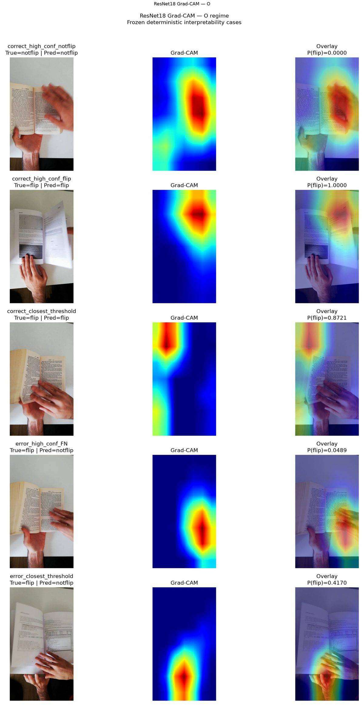
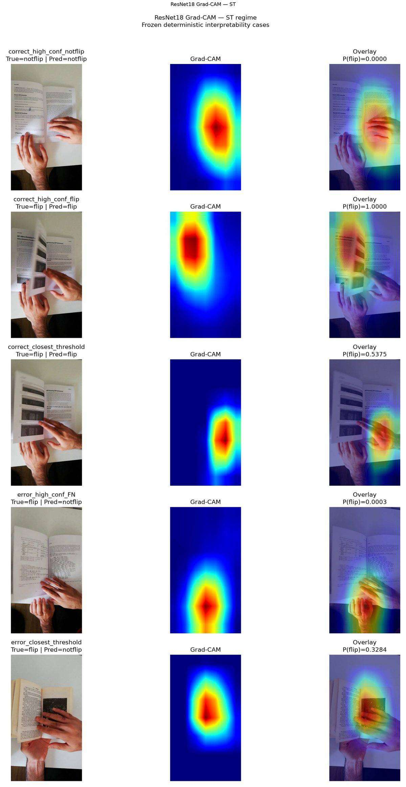

# MonReader Historical Submission Package

This directory is the **submission-ready reconstruction of the original five-notebook MonReader analysis**.

> **Authority boundary:** these notebooks document the historical pre-V2 workflow. The current V2 protocol on `main` remains scientifically authoritative.

## What a reviewer gets

- five notebooks with a clear narrative and no failed/debug detours;
- portable repository-relative paths;
- corrected historical scratch-winner identities;
- committed CSV result snapshots;
- verified figures;
- final Grad-CAM heatmaps as normal repository assets;
- optional W&B integration with no hard-coded account details;
- a technical report and business recommendations at repository level.

## Recommended reading order

1. [01 — Data audit and historical splits](notebooks/01_data_and_splits.ipynb)
2. [02 — Scratch CNN selection + W&B](notebooks/02_cnn_selection.ipynb)
3. [03 — Model / color comparison](notebooks/03_model_comparison.ipynb)
4. [04 — Generalization and stress testing](notebooks/04_generalization_and_stress_tests.ipynb)
5. [05 — Final analysis and interpretability](notebooks/05_final_analysis.ipynb)

Then read:

- [Technical report](../reports/TECHNICAL_REPORT.md)
- [Business recommendations](../reports/BUSINESS_RECOMMENDATIONS.md)

## Two execution modes

### 1. Report mode — default

Install dependencies and open the notebooks:

```bash
python -m pip install -r submission/requirements.txt
jupyter notebook
```

Report mode does **not** require:

- the original dataset;
- a GPU;
- W&B credentials;
- the original W&B workspace;
- original sweep IDs;
- a Windows-specific directory.

The completed values are committed under [`results/`](results/) and the key final figures under [`assets/figures/final/`](assets/figures/final/).

### 2. Reproduction / W&B mode — optional

Copy `.env.example` to a local `.env` at the repository root and configure your own account.

```bash
MONREADER_ENABLE_WANDB=1
MONREADER_WANDB_PROJECT=my-project
MONREADER_WANDB_ENTITY=my-team
WANDB_API_KEY=...
WANDB_MODE=online
```

A reviewer cannot accidentally launch expensive work merely by running the notebook. New sweep creation and W&B-agent execution require independent gates:

```bash
MONREADER_CREATE_NEW_SWEEP=1
MONREADER_RUN_WANDB_AGENT=1
MONREADER_WANDB_AGENT_COUNT=1
```

Notebook 2 exposes the historical sweep configuration and a generic `run_agent(...)` hook. The actual training callable remains explicit rather than hidden inside the helper.

## Verified historical headline results

| Regime | ResNet18 Macro F1 | Source-video 95% CI |
|---|---:|---:|
| O | 0.994969 | [0.986128, 1.000000] |
| S | 0.958387 | [0.909802, 0.993352] |
| T | 0.909140 | [0.865657, 0.946739] |
| ST | 0.877246 | [0.747988, 0.972281] |

The historical tuned Scratch CNN held-out Macro F1 values were approximately 0.990, 0.440, 0.830, and 0.791 for O/S/T/ST respectively.

## Interpretability

Notebook 5 includes the actual saved Grad-CAM regime panels.





Grad-CAM is diagnostic, not causal. The cases were frozen before visual inspection.

## Integrity rules preserved

The cleaned notebooks do not:

- invent or regenerate historical values;
- silently replace the corrected winners;
- change the frozen 0.50 historical threshold;
- use interpretability results for model selection;
- confuse historical results with current V2 conclusions;
- expose private W&B credentials.
